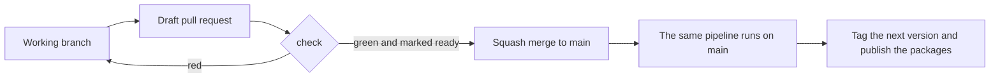

# How toolkit reaches the other repos

`toolkit` deploys nothing: no server runs its code. Three things leave it, and other repos use them. This page says how each one travels, which settings on GitHub protect the path, and how to look after it.

## What leaves this repo

| What                                         | How it travels                                                                           | State on 2026-11-22                                                                |
| -------------------------------------------- | ---------------------------------------------------------------------------------------- | ---------------------------------------------------------------------------------- |
| The pipeline, `.github/workflows/check.yml`  | Another repo's workflow calls it, pinned to a commit of this repo                        | `platform` calls it since 2026-11-22, pinned to the commit of version 1.1.0        |
| The shared files in `packages/dev/shared`    | `zigordev sync` copies them into a repo, and the `shared` rule fails when a copy differs | Used by this repo, by `platform` and by the workspace folder on the owner's laptop |
| The Renovate preset, `renovate/default.json` | Every repo's `renovate.json` extends it, and Renovate reads it from `main` on each run   | Used by this repo and by `platform`                                                |
| The packages, `@zigordev/*`                  | Published to the public npm registry on every merge that changes one                     | `@zigordev/dev` is published since 2026-11-22. Every later package starts private  |

## The path of a change

The pipeline has five jobs, and one gate that passes only when all of them passed:

| Job          | What it checks                                                                    | Runs on                            |
| ------------ | --------------------------------------------------------------------------------- | ---------------------------------- |
| Quality      | `pnpm check`, exactly as on a laptop                                              | Every pull request and every merge |
| Title        | The pull request's title is a Conventional Commit                                 | Pull requests                      |
| Dependencies | No dependency the pull request adds has a known flaw                              | Pull requests                      |
| Code scan    | CodeQL finds no vulnerable pattern in our own code or in the workflows            | Every pull request and every merge |
| Contract     | The product template's two apps keep the platform contract, on their built images | Every pull request and every merge |
| `check`      | Every job above passed                                                            | Every pull request and every merge |

[The pipeline](handbook/the-pipeline.md) explains each job, and how another repo calls it.

A pull request opens as a draft. Marking it ready means: merge it when `check` is green. Nobody merges by hand.

Its description has six sections: What, Why, How it was tested, Observability, Docs and Follow-ups. A pull request opened on GitHub's site starts with them, because the template in `.github/pull_request_template.md` is one of the shared files. The squash merge turns the title and the description into the commit on `main`.

## The release

After a merge to `main`, and only when `check` is green there, the release runs. It is `release.yml`, three jobs that each may do one thing:

| Job     | What it does                                                                                                                        | What it may do                                 |
| ------- | ----------------------------------------------------------------------------------------------------------------------------------- | ---------------------------------------------- |
| Version | semantic-release reads the titles merged since the last version, tags the next one and writes the release notes on GitHub           | Write tags and releases in this repo           |
| Pack    | Builds the packages, writes the version into each one, and packs those that npm does not have yet                                   | Read the repo. It runs the build tools         |
| Publish | Hands each packed file to npm. npm checks with GitHub that this workflow of this repo is the sender, so no token is stored anywhere | Ask GitHub for that proof. It installs nothing |

The job that can publish runs no code from our dependencies, and the job that runs them can neither publish nor write to the repo.

The title of the merged pull request decides the version:

| Title                                                   | Next version                         |
| ------------------------------------------------------- | ------------------------------------ |
| `fix: …` or `perf: …`                                   | A patch, such as 1.4.0 to 1.4.1      |
| `feat: …`                                               | A minor, such as 1.4.1 to 1.5.0      |
| `!` after the type, or a line `BREAKING CHANGE:`        | A major, such as 1.5.0 to 2.0.0      |
| Any other type, such as `docs`, `ci`, `test` or `chore` | None. Nothing is tagged or published |

A package that is marked `"private": true` is never packed or published, and while a repo has no public package, nothing is tagged. That is the switch a new package starts with.

The release starts from what npm lacks at the latest version, not from what just changed. A release that failed halfway therefore finishes with the next merge.

## The settings on GitHub

They were set by hand when the repo was created, on 2026-11-21 and 2026-11-22. From phase 3 they are code in `platform`.

| Setting                                | Value                                                                                                                 | Why                                                                                                          |
| -------------------------------------- | --------------------------------------------------------------------------------------------------------------------- | ------------------------------------------------------------------------------------------------------------ |
| Visibility                             | Public                                                                                                                | It keeps the pipeline, the code scan and the dependency checks free                                          |
| Merging                                | Squash only, with the pull request's title and description as the commit                                              | One commit per change on `main`, in one format                                                               |
| Branches                               | Deleted after a merge                                                                                                 | No stale branches                                                                                            |
| Ruleset on `main`                      | A pull request is required, `check` is required, no force push, no deletion, linear history, and nobody can bypass it | Nothing reaches `main` unchecked                                                                             |
| Dependency graph and Dependabot alerts | On                                                                                                                    | Dependency Review needs the graph, and the alerts tell the owner about a flaw in a dependency already in use |
| Secret scanning with push protection   | On                                                                                                                    | A push that holds a known kind of secret is refused                                                          |
| The token a workflow gets              | Read-only                                                                                                             | A job asks for each right it needs                                                                           |

## Looking after it

| Situation                                          | What to do                                                                                                                                                                                                                                                                                                                            |
| -------------------------------------------------- | ------------------------------------------------------------------------------------------------------------------------------------------------------------------------------------------------------------------------------------------------------------------------------------------------------------------------------------- |
| `main` is red                                      | Fix it or revert the change before any other work. The run is under Actions, in the workflow named CI                                                                                                                                                                                                                                 |
| A pull request's Quality job is red                | `pnpm check` on the branch shows the same failure                                                                                                                                                                                                                                                                                     |
| Its Title job is red                               | Rewrite the title as `type(scope): summary`, in lower case, with no final period                                                                                                                                                                                                                                                      |
| Its Dependencies job is red                        | The job's summary names the dependency and its flaw. Take a fixed version, or do without it. When another package brings it in, `pnpm why <name> -r` shows which one, and [record 0033](adr/0033-a-flawed-dependency-of-a-dependency-is-replaced-by-an-override.md) says what to do                                                   |
| The Release is red on `main`                       | Read which of its three jobs failed. Version: the titles could not be read, or the tag could not be written. Pack: the build failed. Publish: npm refused, most often because the package is not tied to this repo yet or the tie has expired, which only the owner can renew. The next merge finishes a release that stopped halfway |
| Its Code scan job is red                           | The job's log lists each open finding with a link. Fix the code                                                                                                                                                                                                                                                                       |
| GitHub emails a Dependabot alert                   | Read which package it names and what brings it in, with `pnpm why -r <package>`. Renovate opens the pull request for a fixed version when one exists                                                                                                                                                                                  |
| A pull request from Renovate is red, or stays open | [Dependency updates](handbook/dependency-updates.md) says what each case means                                                                                                                                                                                                                                                        |
| A change has to be undone                          | Revert it through a pull request. Once packages are published, the revert publishes a new version                                                                                                                                                                                                                                     |
| A job in `check.yml` is renamed                    | The name of the gate, `check`, is what the ruleset requires in every repo. A job behind it may change, and the gate may not be renamed without changing every ruleset                                                                                                                                                                 |
