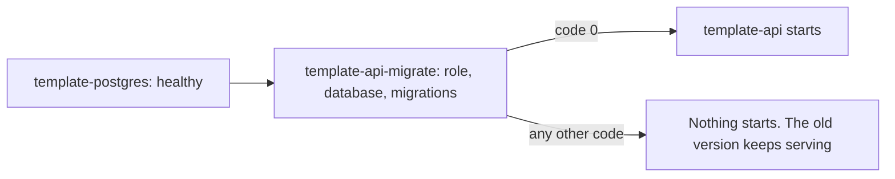

# Data

## What it is

Each product keeps its data in its own PostgreSQL 18 server: one container in the product's compose file, on a network of its own, with its files in a volume. Inside it, each app that keeps data has its own database and its own role, and no app reads another app's database.

| Piece            | What it does                                                                                    |
| ---------------- | ----------------------------------------------------------------------------------------------- |
| PostgreSQL 18    | The database server, one per product, from the official image                                   |
| Drizzle          | The app's queries in TypeScript, over a pool of node-postgres connections                       |
| drizzle-kit      | Writes the SQL of each change to the schema, as a migration file in the app's `drizzle/` folder |
| The migrate job  | A one-shot container on the app's own image that applies the migrations before the app starts   |
| `@zigordev/api`  | `addDatabase` for the app, `migrateDatabase` for the job, and paging by keyset                  |
| `@zigordev/test` | A real PostgreSQL for the tests, with one migrated copy per test file                           |

## Why we have it, and what we would lose without it

A server per product lets a product start, upgrade and restore on its own. [Record 0017](../adr/0017-one-postgresql-server-per-product.md) holds that decision. One role per app means a fault in one app can only reach its own data.

Migrations as SQL files mean every change to the data is read in review as plain SQL, and applied exactly once in every environment. Without the job, each app would migrate as it starts, and two copies of an app starting side by side during a deploy would race for it.

## How it works here, on the laptop and in production

- **The job.** It is the service `<app>-migrate`, on the app's image, with the command `node src/migrate.ts`. With the superuser's address it makes the app's role and database, or sets the role's password to the current one, so a rotated password reaches the database with the next deploy. Then it applies, as the app's role, every migration not applied yet. Its log lines are `migration.started`, `migration.finished` with how many it applied, and `migration.failed`.
- **On the laptop** the app waits for the job with `depends_on`, so `pnpm local:up` migrates first. The server also answers at a port on `127.0.0.1`, which `pnpm dev` uses.
- **In production** the deploy starts the stores, runs each job once with the new version, and starts the new containers only when the job ended with code 0. [Record 0035](../adr/0035-labels-tell-the-platform-what-a-service-is.md) sets the labels that tell the platform which service is a job and which is a store.
- **Steps a deploy can live with.** For a moment the old version runs beside the new one, against the migrated database. So a change comes in steps: add a column first, switch the code to it, and remove the old one in a later pull request. A migration that deletes data, a table or a column waits for the owner: in a pull request, the `migrations` rule of `zigordev check` fails on it until the owner adds the label `destructive-migration`.
- **Backups.** Every hour the host dumps each database from inside the store's container. That is why the store's memory limit is higher than the database needs at rest: the dump runs within it.

## How to use it, with one worked example

To add a column `pinned` to the notes of the template:

1. Add `pinned: boolean().notNull().default(false)` to the table in `apps/template-api/src/db/schema.ts`. A new column has a default, so that the running version can still insert rows.
2. Run `pnpm --dir template/apps/template-api run db:generate --name add_notes_pinned`. drizzle-kit writes `drizzle/0001_add_notes_pinned.sql` and its snapshot.
3. Read the SQL: `ALTER TABLE "notes" ADD COLUMN "pinned" boolean DEFAULT false NOT NULL;`. Commit it as it is. A migration that has run anywhere is never edited.
4. Run the API's database tests: `pnpm exec vitest run --project template-api:db`. Their global setup migrates the template database with every migration, so a broken one fails every file.

Timestamps are stored with a precision of 3, in milliseconds, so that a cursor of a list holds them exactly. A table has a `uuid` key that defaults to `uuidv7()`, and `created_at` and `updated_at`.

## How to check that it works, and what to do when it does not

- `docker logs <product>-<app>-migrate-1` shows the job's lines. `migration.finished` with `applied` and `total` says what it did.
- The app's health route lists `db`. It answers 503 while the database cannot be reached.
- A job that ends with code 1 keeps the app from starting. Its `migration.failed` line holds the error from PostgreSQL: fix the migration in a new one, never in the old file.
- `pnpm local:reset` deletes the product's data on the laptop and starts again from the migrations.
