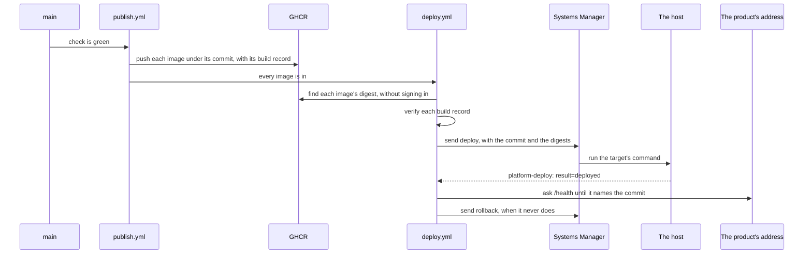

# Delivery

## What it is

Delivery takes a product from a green merge on `main` to a running version on the host, and back again when the new version answers wrongly. Nobody runs a step of it by hand.

It has two halves, built together in step 3.7 of the Build plan:

| Half       | What it holds                                                                                                                                                                                                      |
| ---------- | ------------------------------------------------------------------------------------------------------------------------------------------------------------------------------------------------------------------ |
| `toolkit`  | Two reusable workflows that a product's caller runs after `check` on `main`. `publish.yml` builds, pushes and attests the product's images. `deploy.yml` verifies them and asks the host to run them               |
| `platform` | The host's deploy script with docker-rollout, one command document and one role in AWS per deploy target, and the GitHub environment `production` in each repo that deploys. Its own docs describe the host's side |

Two words come up on every line of this page:

- **A digest** is the content hash of an image, such as `sha256:4f2a…`. A tag such as `:1f3a9c2` can be moved to another image, a digest cannot.
- **A build record**, which GitHub calls an artifact attestation, is a signed statement that says which workflow built an image, from which repo and which commit. GitHub signs it with a short-lived certificate, and anyone can check it.

[Record 0010](../adr/0010-every-green-merge-deploys.md) decided that every green merge of a product deploys it, and [record 0011](../adr/0011-the-pipeline-pushes-each-deploy.md) that the pipeline pushes each deploy through AWS Systems Manager.

## Why we have it, and what we would lose without it

- Without it, a person would deploy by hand. A deploy would be slower, would differ from one time to the next, and nothing would record which commit runs.
- Without the build records, the host would run any image that sits under our name in the registry, whoever pushed it there.
- Without the digests, the image the deploy checked and the image the host pulls could differ, because a tag can move between the two.
- Without the outside check, a version that the host found healthy, but that cannot be reached from the internet, would stay.
- Without the rollback, a bad version would serve until a person noticed it.

## How it works here, on the laptop and in production

Nothing deploys from the laptop. `pnpm local:up` builds a product's images under the version `local`, and runs the same compose files that the host runs.

In production a merge travels like this:



### The names

| Thing            | Value                                                                                                                        |
| ---------------- | ---------------------------------------------------------------------------------------------------------------------------- |
| Deploy target    | A product's name in `platform/infra/products.json`, or `platform` for the shared services                                    |
| Image            | `ghcr.io/zigordev/<app>:<commit>`, where `<app>` is `<product>-<part>` and `<commit>` is the full commit of 40 characters    |
| Version          | The full commit, everywhere: the image's tag, `VERSION`, `OTEL_SERVICE_VERSION` and `version` in the answer of `/health`     |
| Command document | `platform-deploy-<target>` in AWS Systems Manager, in `eu-west-1`. It runs the host's deploy script for that target          |
| Role             | `platform-deploy-<target>` in AWS IAM. It trusts only the repo of the target, and only a job in its environment `production` |
| Environment      | `production`, in every repo that deploys, limited to `main`                                                                  |
| Secret           | `AWS_ACCOUNT_ID` in every repo that deploys, which the owner sets. It is a secret because variables show in the public logs  |
| Host             | The instance tagged `Name=platform-host`                                                                                     |

### The publish workflow

`publish.yml` has two jobs.

1. **Plan** refuses to run anywhere but on `main`. It reads the product's `compose.yaml` and `compose.local.yaml`, and lists each app that the local file builds into an image of `ghcr.io/zigordev/`, once, with its build folder and its Dockerfile.
2. **Image** runs once per app, on one of GitHub's arm64 machines, because the host is arm64. It builds the image for `linux/arm64`, labels it with the repo and the commit, and pushes it as `ghcr.io/zigordev/<app>:<commit>`. It then reads the image's digest back from GHCR and attests it with GitHub's own action, `actions/attest`. The build record is stored in GitHub and pushed into the registry beside the image.

GitHub keeps a storage record of an image only for repos of an organisation, and `zigordev` is a personal account, so the workflow asks for none.

The host pulls without signing in, so every image package is public. GitHub can create a new package as private. Then the owner makes it public once, in the package's settings, and the deploy says so when it cannot see an image.

| Job   | Permissions                                                                                                    |
| ----- | -------------------------------------------------------------------------------------------------------------- |
| Plan  | `contents: read`                                                                                               |
| Image | `contents: read`, `packages: write` to push, `id-token: write` to sign the build record, `attestations: write` |

### The deploy workflow

`deploy.yml` has one job, named Deploy. It takes three inputs and one secret:

| Input            | Holds                                                                                                              |
| ---------------- | ------------------------------------------------------------------------------------------------------------------ |
| `target`         | The deploy target. Required                                                                                        |
| `compose-dir`    | The folder of `compose.yaml` and `compose.production.yaml`, the same one the host reads. `.` by default            |
| `health-url`     | The address to ask from outside, such as `https://gpool.zigordev.com/health`. Without it there is no outside check |
| `AWS_ACCOUNT_ID` | The secret that the role's address needs                                                                           |

The job runs in the environment `production`, in the concurrency group `deploy-<target>`, and never cancels a deploy that runs. GitHub keeps one more run waiting, and a newer run replaces an older one that waits. It may read the repo and the build records, and ask GitHub for the short-lived proof that AWS trusts: `contents: read`, `attestations: read` and `id-token: write`. It installs nothing.

1. **It checks the inputs.** The target is a name in lowercase letters, digits and dashes. The run is on `main`. The folder lies inside the repo. The address starts with `https://`.
2. **It verifies the images.** It lists the target's images with `docker compose config --images`, with `VERSION` set to the commit, and keeps those under `ghcr.io/zigordev/`. For each one it finds the digest without signing in, the way the host pulls, and runs `gh attestation verify`. A build record passes only when it came from this repo, at this commit, on `main`, from toolkit's `publish.yml`, on a machine of GitHub's own. One failure stops the run before AWS is called.
3. **It deploys.** It signs in with the target's role and sends the command `deploy`, with the commit and the verified list of `ghcr.io/zigordev/<app>@sha256:<digest>`. It waits up to 16 minutes for the host's answer, and shows what the host wrote in a folded part of the log.
4. **It checks from outside.** When the host has deployed and `health-url` is set, it asks that address every 5 seconds until `version` is the commit, for at most 120 seconds. On a wrong or missing answer it sends `rollback` for the commit, and fails the run, naming the commit that serves again.
5. **It writes a summary** on the run's page: the target, the commit, the version before it, and the result.

What the host and the product write never acts as a command of GitHub's runner. The job fences their text off with GitHub's `stop-commands`, so a line such as `::error::` in it is shown as text.

### The host's answer

The host writes one line that starts with `platform-deploy:`. The last such line is the result:

| Result                                                               | Means                                                                                                                                                                                                                                                                        | The run                   |
| -------------------------------------------------------------------- | ---------------------------------------------------------------------------------------------------------------------------------------------------------------------------------------------------------------------------------------------------------------------------- | ------------------------- |
| `result=deployed target=<t> commit=<c> previous=<c0>`                | The new version passed the host's health gate and serves                                                                                                                                                                                                                     | Checks from outside       |
| `result=skipped reason=overtaken target=<t> commit=<c> current=<c1>` | A newer commit already runs                                                                                                                                                                                                                                                  | Ends green, with a note   |
| `result=failed reason=<step> target=<t> commit=<c> restored=<c0>`    | A step failed: `pull`, `start`, `job`, `health`, `orphans`, `record`, or `unexpected` for an error nobody foresaw. `restored` names the version that serves again, `none` on a first deploy, or `failed`                                                                     | Fails, naming what serves |
| `result=refused reason=<word> target=<t> commit=<c>`                 | Nothing changed. `busy`: another deploy of the target held its lock for 14 minutes. `unreachable`: GitHub or Parameter Store did not answer. Others are `missing-secrets`, `unverified-image`, `unpinned-image`, `not-on-main`, `not-current`, `no-previous` and `bad-input` | Fails                     |
| `result=rolled-back target=<t> commit=<c0> from=<c>`                 | The answer to `rollback`: the version before `<c>` serves again                                                                                                                                                                                                              | Fails, naming `<c0>`      |

The role may send its own target's command to the host and read the result, and nothing else. It cannot read a secret, open a shell on the host, or touch another target.

### What a product's compose files hold

The host reads three files of the product from `main`: `compose.yaml`, `compose.production.yaml` and `.env.production.example`. They have to hold seven things, or the host refuses or fails the deploy, and an eighth, or the backup on the host never finds the product's database. `zigordev contract` checks all of them on every pull request, as part of promise 7 of [the contract](the-platform.md), so a product learns it there and not on the host.

| Rule                                                                                                                                                                                                                          | Why                                                                                                                                                                                                |
| ----------------------------------------------------------------------------------------------------------------------------------------------------------------------------------------------------------------------------- | -------------------------------------------------------------------------------------------------------------------------------------------------------------------------------------------------- |
| `compose.yaml` starts with `name: <product>`                                                                                                                                                                                  | It is the name of the Compose project on the host                                                                                                                                                  |
| Our images are `ghcr.io/zigordev/<product>-<part>:${VERSION:-local}`, beside `OTEL_SERVICE_VERSION: ${VERSION:-local}`                                                                                                        | The host sets `VERSION` to the commit, so the image and the telemetry name the same version                                                                                                        |
| Every other image is pinned as `name:tag@sha256:<digest>`                                                                                                                                                                     | The host runs exactly the image that was checked. [Record 0038](../adr/0038-images-of-others-are-pinned-by-their-digest.md) holds the decision                                                     |
| Every long-running service has `restart: unless-stopped`, and a job `restart: "no"`                                                                                                                                           | The host restarts itself at night for its updates, and everything has to come back                                                                                                                 |
| A service that Traefik routes has no `container_name` and no `ports`                                                                                                                                                          | docker-rollout runs the new version beside the old one for a moment, and two containers cannot share a name or a port                                                                              |
| Its health check fails while `/tmp/drain` exists, `/tmp` is in memory, and it has the label `docker-rollout.pre-stop-hook: "touch /tmp/drain && sleep <S>"`, where S is the check's interval times its retries plus 5 seconds | docker-rollout runs that hook in the old container. Its health check then fails, Traefik takes it out, and it stops only after that, so no request is cut off                                      |
| `.env.production.example` names every secret as `NAME=`, with no value, and the compose files use no other variable but `VERSION` and `DOCKER_SOCKET_GROUP`                                                                   | The host reads each name from Parameter Store under `/<product>/<NAME>`, and gives compose those values and no others                                                                              |
| Every service on the official `postgres` image has the label `com.zigordev.backup: postgres`, and that label names no other kind                                                                                              | The backup on the host finds each database by that label, so a database without it is never backed up. [Record 0035](../adr/0035-labels-tell-the-platform-what-a-service-is.md) holds the decision |

`compose.production.yaml` also routes the product to `<product>.zigordev.com`, whose `/health` answers with `version`. The deploy asks that address from outside.

The drain is easiest to see in the template's `compose.yaml`:

```yaml
tmpfs:
  - /tmp:uid=1000,gid=1000,size=1m
healthcheck:
  test:
    [CMD-SHELL, "test ! -e /tmp/drain && wget -q -T 4 -O /dev/null http://127.0.0.1:3000/health"]
  interval: 10s
  retries: 3
labels:
  traefik.enable: "true"
  docker-rollout.pre-stop-hook: "touch /tmp/drain && sleep 35"
```

docker-rollout reads the label from the old container, so draining starts with the second deploy of a service.

## How to use it, with one worked example

A product's caller runs four jobs: the pipeline and its gate, as [the pipeline](the-pipeline.md) shows, and then publish and deploy, on a push to `main` only. The three `uses` lines name the same commit of `toolkit`, with its version beside it:

```yaml
jobs:
  pipeline:
    name: Pipeline
    uses: zigordev/toolkit/.github/workflows/check.yml@<commit> # <version>
    with:
      product-folder: .
    permissions:
      contents: read
      security-events: write

  check:
    name: check
    needs: [pipeline]
    if: always()
    runs-on: ubuntu-26.04
    timeout-minutes: 5
    permissions: {}
    steps:
      - name: Pass only when every job passed
        env:
          RESULT: ${{ needs.pipeline.result }}
        run: |
          echo "The pipeline ended with: $RESULT"
          test "$RESULT" = "success"

  publish:
    name: Publish
    needs: [check]
    if: github.event_name == 'push'
    uses: zigordev/toolkit/.github/workflows/publish.yml@<commit> # <version>
    permissions:
      contents: read
      packages: write
      id-token: write
      attestations: write

  deploy:
    name: Deploy
    needs: [publish]
    if: github.event_name == 'push'
    uses: zigordev/toolkit/.github/workflows/deploy.yml@<commit> # <version>
    with:
      target: gpool
      health-url: https://gpool.zigordev.com/health
    secrets:
      AWS_ACCOUNT_ID: ${{ secrets.AWS_ACCOUNT_ID }}
    permissions:
      contents: read
      id-token: write
      attestations: read
```

A caller grants each called workflow every permission that its jobs ask for. GitHub checks that when the run starts, and a missing one fails the whole run at once.

Before its first deploy, a product needs four things, and none of them is in the product's own repo:

1. Its entry in `platform/infra/products.json`. `platform` makes the command, the role and the environment `production` from it.
2. The secret `AWS_ACCOUNT_ID`, which the owner sets in the repo.
3. Each name in its `.env.production.example`, with its value, in Parameter Store under `/<product>/<NAME>`. The owner sets them.
4. Its image packages made public, once, after the first publish.

A product that sends email, as one made from the template does once sign-in is on, also needs its Kafka user, its topics and their rules in `platform`, and then its line in the `producers.json` of the notifications service, in that order: the service stops reading every request topic while one of them is missing, as [the template's README](../../template/README.md#what-the-broker-and-the-service-need-first) says. Its Kafka password is one of the names in step 3: `KAFKA_PASSWORD`, at `/<product>/KAFKA_PASSWORD`, which the shared services read as well.

`platform` deploys the shared services through the same workflow, with no images of its own and no outside check:

```yaml
with:
  target: platform
  compose-dir: stack
```

## How to check that it works, and what to do when it does not

| Try this                                                 | What must happen                                                                            |
| -------------------------------------------------------- | ------------------------------------------------------------------------------------------- |
| Merge a green pull request in a product                  | Publish and Deploy run after `check`, and the run's summary names the commit and `deployed` |
| Open `https://<product>.zigordev.com/health`             | `version` is the commit of the newest merge                                                 |
| Merge a version whose `/health` answers 503 from outside | The run fails after 120 seconds, and its summary names the commit that serves again         |
| Merge twice in a row, quickly                            | The second deploy waits for the first. A third merge replaces the second while it waits     |

| What the run says                                              | What it means                                                                     | What to do                                                                                            |
| -------------------------------------------------------------- | --------------------------------------------------------------------------------- | ----------------------------------------------------------------------------------------------------- |
| `Images are published from main only` or `Only main deploys`   | A caller ran Publish or Deploy from a branch                                      | Call both only on a push to `main`, as the example does                                               |
| `GHCR shows no image … to a visitor who is not signed in`      | The image was not pushed, or its package is private                               | Look at the Publish run. For a new package, the owner makes it public in its settings                 |
| `… has no build record from …`                                 | The image was not built by toolkit's `publish.yml` from this repo at this commit  | Never push an image by hand. Run the merge's pipeline again only with the owner's yes                 |
| `Write it as ghcr.io/zigordev/<app>:${VERSION:-local}`         | The compose files run one of our images under a fixed tag                         | Use `VERSION` in the image's tag                                                                      |
| `No host took the command … within 2 minutes`                  | No running instance has the tag `Name=platform-host`, or its agent is down        | The host's runbook in `platform`                                                                      |
| `refused … missing-secrets`                                    | A name in `.env.production.example` has no value in Parameter Store               | The host's output lists the names. The owner sets each one                                            |
| `failed on the host at <step>, and <c0> serves again`          | A step failed, and the host put the version before it back                        | The host's output, in the folded part of the log, names what failed                                   |
| `… could not be brought back, so the product may be down`      | A step failed, and the version before it did not come back either                 | Tell the owner at once. The host's runbook in `platform` says how to bring a version back by hand     |
| `refused … busy`                                               | Another deploy of the same target held the host's lock for 14 minutes             | Look for a deploy that hangs. Run the merge's pipeline again only with the owner's yes                |
| `refused … unreachable`                                        | The host could not reach GitHub or Parameter Store, and changed nothing           | Wait a few minutes. Run the merge's pipeline again only with the owner's yes                          |
| `did not name … within 120 seconds, so the host rolls it back` | The host found the version healthy, but the address does not answer with it       | Look at the route, the tunnel and the app's `/health`. The summary names the commit that serves again |
| `The rollback did not happen`                                  | The new version may still serve, such as on a first deploy with nothing before it | Fix forward with a new merge, or ask the owner                                                        |
