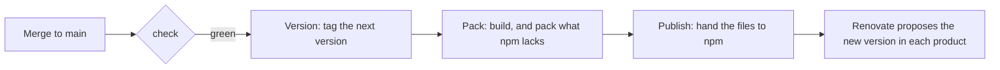

# Packages

## What it is

The shared code of the platform lives in `toolkit` as packages. A package is a folder under `packages/` with a name such as `@zigordev/dev`. It is published to npm, the public registry that every JavaScript project installs from, and a product installs it like any other dependency.

Three things hold for every package:

| Rule                     | What it means                                                                                      |
| ------------------------ | -------------------------------------------------------------------------------------------------- |
| One version              | All packages of a repo share one version. "This product is on toolkit 1.4.0" says everything       |
| Published on every merge | A merge that changes a package publishes all of them under the next version, within minutes        |
| No stored secret         | npm trusts GitHub's proof of which pipeline is publishing. No password and no key is kept anywhere |

[Record 0007](../adr/0007-packages-on-public-npm-unlicensed.md) and [record 0008](../adr/0008-one-version-published-on-every-merge.md) hold the decisions. `platform` and `notifications` publish one package each in the same way.

## Why we have it, and what we would lose without it

Without packages, every product would carry its own copy of the shared code, and a fix made in one copy would stay missing in the others.

Without one version, a product could mix versions of packages that were never tried together.

Without the pipeline doing the publishing, a person would publish from a laptop with a stored token. A token can leak, and every release would wait for that person.

## How it works here, on the laptop and in production

Nothing of this runs on the laptop or on the host. It runs in the pipeline, after a merge to `main`, and only when `check` is green there.



Each of the three jobs may do one thing. [How toolkit reaches the other repos](../cloud-first-deploy.md) lists what each one may do, and which title gives which version.

### What a package ships

A package that is packed holds exact versions where the repo writes `catalog:`. So a product that installs `@zigordev/otel` gets the very version of pino that `toolkit` tested it with, and a newer pino reaches the product only with a newer version of the package.

Those versions live in a catalog of their own in `pnpm-workspace.yaml`, named `shipped`. A package under `packages/` takes every entry of its `dependencies` from it, written as `catalog:shipped`. The tools, the test libraries and the apps' versions live in the default catalog, written as `catalog:`:

```yaml
catalog:
  vitest: 5.1.1

catalogs:
  shipped:
    pino: 10.4.0
```

The two catalogs tell Renovate what ships. An update of `shipped` is titled `fix(deps)`, so its merge publishes the packages, and every other update stays a `chore`. [Dependency updates](dependency-updates.md) says why Renovate needs the second catalog to tell them apart. `packages/dev/src/workspace.test.ts` holds the split: no package takes a dependency from the default catalog, `shipped` holds nothing that no package ships, and no version lives in both.

### How npm knows the pipeline

For each package, npm keeps a note: this package may be published by the workflow `ci.yml` of the repo `zigordev/toolkit`, in the environment named `release`. When the Publish job runs, GitHub signs a short proof of which workflow of which repo is running. npm compares the proof with its note. No secret exists that could leak.

Two rules of npm shape how a package starts:

- npm takes such a note only for a package that already exists. So a first version has to be published by a person, once.
- A new note expires unless the pipeline publishes through it within 2 days. So that first publish happens when the package is ready, and not long before.

Nothing has to be reserved in advance. Every name that starts with `@zigordev/` belongs to the npm account `zigordev`.

### A package starts private

A new package is marked `"private": true` in its `package.json`. The release never packs or publishes a private package, and while a repo has no public package, it tags nothing.

The package goes public in three moves: the owner makes its first publish, one line is removed from its `package.json`, and the next release publishes it.

### A release finishes itself

The release does not ask what just changed. It asks which packages npm lacks at the latest version. A release that stopped halfway therefore finishes with the next merge, and nobody has to repair it.

## How to use it, with one worked example

In a product, a shared package is a dependency like any other, and Renovate proposes each new version.

The worked example is a new package, `@zigordev/config`, from its first line to npm.

1. **It is added, private.** A pull request adds `packages/config`, with `"private": true`. It merges, and nothing is published.
2. **The owner makes its first publish.** In the repo's folder, in a terminal:

   ```bash
   pnpm exec zigordev first-publish @zigordev/config
   ```

   The command signs in to npm in the browser when needed. It publishes an empty version 0.0.0 from a throwaway folder, and ties the name to this repo. npm asks for the second factor on the way. With `--dry-run` in front of the name, the command only says what it would do.

3. **It goes public.** A pull request removes the line `"private": true`. Its title starts with `feat`, so the release tags a new minor version and publishes every package under it, the new one too. This has to merge within 2 days of the first publish.
4. **A product takes it.** The product adds the package, and from then on Renovate proposes each new version.

Only the owner of the npm account can do step 2. The command refuses to run without a person at a terminal, so a session cannot run it by mistake.

## How to check that it works, and what to do when it does not

| What you see                                                                                                                                  | What it means                                                                                                                                                                | What to do                                                                                                                                                                                |
| --------------------------------------------------------------------------------------------------------------------------------------------- | ---------------------------------------------------------------------------------------------------------------------------------------------------------------------------- | ----------------------------------------------------------------------------------------------------------------------------------------------------------------------------------------- |
| After a merge with `feat` or `fix`: a new tag, notes and a version on npm                                                                     | The release works                                                                                                                                                            | Nothing                                                                                                                                                                                   |
| The Version job says that no package is public                                                                                                | Every package of the repo is still private                                                                                                                                   | Nothing. It is how a repo starts                                                                                                                                                          |
| A merge published nothing                                                                                                                     | Its title has a type that gives no version, such as `docs`, `ci`, `test` or `chore`                                                                                          | Nothing. A change to a package is a `feat` or a `fix`                                                                                                                                     |
| The Publish job fails in its step "Check that GitHub offers this job its proof of origin"                                                     | The job, or the job that calls the workflow, lacks the permission `id-token: write`                                                                                          | Give both that permission                                                                                                                                                                 |
| The Publish job fails, and npm says it needs a sign-in (`ENEEDAUTH`). Higher up, its log says `OIDC token exchange error - package not found` | npm received GitHub's proof and found no tie that matches it. The package was never tied to this repo, the tie has expired, or it names another workflow file or environment | The owner runs `npm trust list <package>`. With no tie, or an expired one that `npm trust revoke` removes first, the owner runs the first-publish command again. The next merge publishes |
| The Publish job passes, and npm does not show the version yet                                                                                 | npm says that the package "is being processed". On 2026-11-22 it took about five minutes                                                                                     | Wait. The next run gives npm seven minutes before it calls the version missing                                                                                                            |
| A version is tagged, and npm does not have it                                                                                                 | The release stopped between its jobs                                                                                                                                         | Read the failed job. The next merge to `main` publishes what is missing                                                                                                                   |
| `workspace.test.ts` fails and names a dependency                                                                                              | A package takes it from the default catalog, or the catalog `shipped` holds what no package ships, or a version is in both                                                   | Move the version to the catalog it belongs to, and write `catalog:shipped` or `catalog:` beside it                                                                                        |
| `zigordev release plan` on a laptop                                                                                                           | It prints the public packages that npm lacks at the latest version, and changes nothing                                                                                      | Use it to see what the next release would publish                                                                                                                                         |
