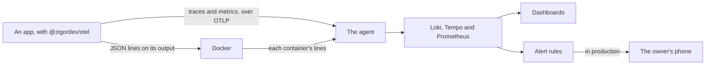

# Telemetry

This page covers what phase 2 built: telemetry on the laptop, from an app to a dashboard. Production's side arrives in phase 3, and the last section of "How it works here" says what is still missing.

## What it is

Telemetry is what a running app reports about itself. It comes in three kinds.

| Kind     | What it is                                                            | Example                                    |
| -------- | --------------------------------------------------------------------- | ------------------------------------------ |
| Log line | One thing that happened, written as one line of JSON                  | `greeting.sent`                            |
| Trace    | The journey of one request, as timed steps. One step is called a span | A page, its call to the API, and the route |
| Metric   | A number that is counted or measured over time                        | Requests by route, and how long they took  |

Five pieces carry it from an app to a person.

| Piece                      | Where it lives                                      | What it does                                                                                      |
| -------------------------- | --------------------------------------------------- | ------------------------------------------------------------------------------------------------- |
| `@zigordev/otel`           | In every TypeScript app, from `toolkit`             | Records the traces and the metrics, writes the log lines, and keeps the rules below               |
| The agent, Grafana Alloy   | One of the shared services, from `platform`         | Receives traces and metrics from every app, reads every container's lines, and forwards all of it |
| The stores                 | Inside the local Grafana on the laptop              | Loki keeps the log lines, Tempo the traces, and Prometheus the metrics                            |
| Dashboards and alert rules | Code in `platform`, pushed to Grafana at each start | Show one app or the whole machine, and say when something is wrong                                |
| Runbooks                   | Pages in `platform`, one for each alert             | Say what an alert means, how to check, and how to fix it                                          |



OTLP is the protocol of OpenTelemetry, the open standard for traces and metrics.

## Why we have it, and what we would lose without it

Without telemetry, the only way to learn why a request failed is to ask the visitor, or to guess.

Without one way of doing it, each app would report under its own names. One dashboard and one set of alert rules cover every app only because every app sends the same names. A new app then needs no dashboard of its own: it appears in the list with its first request.

Without the rules below, telemetry stops being worth reading. A probe every ten seconds buries the real requests. A raw path in a metric makes a new series for every id. An address or an email in a span is personal data in a place nobody meant to keep it.

Without it on the laptop, a dashboard or an alert rule could only be tried in production.

## How it works here, on the laptop and in production

### Three ways out of an app

| Kind      | How it leaves the app                              | How the agent gets it                            | Where it is kept |
| --------- | -------------------------------------------------- | ------------------------------------------------ | ---------------- |
| Log lines | As JSON lines on the container's standard output   | It reads each container's output, through Docker | Loki             |
| Traces    | Over OTLP to `http://alloy:4318`, every 5 seconds  | It listens there                                 | Tempo            |
| Metrics   | Over OTLP to `http://alloy:4318`, every 60 seconds | It listens there                                 | Prometheus       |

Log lines never travel over OTLP. An app only writes them, and the agent does the rest. That is why a crash before telemetry starts still leaves its lines.

The agent labels each line with the name of its compose service, as `service_name`, with its `compose_project` and with its `container`. When a line carries a `traceId`, the agent keeps that id beside the line.

### One name everywhere

An app has one name, `<product>-<part>`, such as `template-api`. Its folder, its package, its compose service, its image and its telemetry all use it. Three facts travel with everything an app sends:

| Fact                          | Comes from                                                | In a metric, it is the label  |
| ----------------------------- | --------------------------------------------------------- | ----------------------------- |
| `service.name`                | `OTEL_SERVICE_NAME`, set in `compose.yaml`                | `service_name`                |
| `service.version`             | `OTEL_SERVICE_VERSION`, the same value as the image's tag | `service_version`             |
| `deployment.environment.name` | `OTEL_RESOURCE_ATTRIBUTES`, `local` or `production`       | `deployment_environment_name` |

### The rules every app keeps

| Rule                                     | Why                                                                                   | What keeps it                                                                                                      |
| ---------------------------------------- | ------------------------------------------------------------------------------------- | ------------------------------------------------------------------------------------------------------------------ |
| One name, the same everywhere            | Logs, traces, metrics and dashboards line up with no mapping                          | The template's compose test, and promise 5 of the contract test                                                    |
| Every line is one JSON object            | The agent reads every app the same way, and knows each line's level                   | `@zigordev/otel` captures what libraries print. Promise 4 of the contract test                                     |
| An event is named `area.what_happened`   | Dashboards and alerts search for the name, so it never changes its meaning            | The code that writes it. `service.started` and `service.stopping` come ready                                       |
| A level means the same in every app      | `error`: a person should look. `warn`: handled. `info`: life and business events      | The code that writes it                                                                                            |
| A metric's labels hold few, fixed values | A route pattern makes one series. A raw path, an id or an email makes one per visitor | `nameRoute` gives the pattern. A request that matches no route gets no name                                        |
| Nothing identifies a visitor             | Telemetry is kept for weeks, and read by people who never needed the visitor's data   | `@zigordev/otel` strips the address, the user agent and the query string. Promises 4 and 5 of the contract test    |
| A probe leaves no trace                  | A health check every ten seconds would bury the real requests                         | `@zigordev/otel` skips `/health`, `/favicon.ico` and `/_next/static/`                                              |
| Background work starts no trace          | A timer that polls would fill the store                                               | A query or an outgoing call gets a span only inside another span                                                   |
| Every trace is kept                      | With little traffic, the one request that failed must be there                        | Nothing is sampled                                                                                                 |
| The last telemetry is sent before a stop | A deploy would otherwise lose the last seconds of the old version                     | `shutdownTelemetry()`. The API keeps it. The web app does not yet, as "Known limits" in the template's README says |

[The README of `@zigordev/otel`](../../packages/otel/README.md) explains each of them from the app's side, with every field of a log line.

### What an app reports with no code of its own

| What                                               | As                                                               |
| -------------------------------------------------- | ---------------------------------------------------------------- |
| Each request that comes in                         | A span, and the metric `http.server.request.duration`            |
| Each request it makes, with `fetch` or `node:http` | A span, and the metric `http.client.request.duration`            |
| Each PostgreSQL query                              | A span, and the numbers of the connection pool                   |
| The Node.js runtime                                | Metrics of the event loop, the memory and the garbage collection |
| Its start and its stop                             | The events `service.started` and `service.stopping`              |

Prometheus writes a metric's name with underscores and its unit. `http.server.request.duration` is stored as `http_server_request_duration_seconds`, with `_count`, `_sum` and `_bucket` at the end.

### From a line to its trace, and back

A line that is written inside a request carries the request's `traceId`. In Grafana such a line has a link named Trace, which opens the whole request. A trace lists its own log lines the same way. So a person starts from whichever they found first: the error line, or the slow request.

### Dashboards and alert rules

Both are code in `platform`. On the laptop they are pushed to the local Grafana each time the shared services start.

| In Grafana                              | What it shows                                                                                                                                  |
| --------------------------------------- | ---------------------------------------------------------------------------------------------------------------------------------------------- |
| Dashboards, folder `zigordev`, App      | One app, picked from a list: whether it reports, its version, its requests, the share that fail, its response times, its events and its errors |
| Dashboards, folder `zigordev`, Platform | The machine's processor, memory and disks, the requests at the ingress, and who is reporting                                                   |

The App dashboard lists every app that sends `http.server.request.duration`. It needs four things of an app, and `@zigordev/otel` gives all four: that metric, with `http.route` and `http.response.status_code` on it, the app's name and version, and log lines with a `level` and an `event`.

| Alert rule                 | Fires when                                                                   |
| -------------------------- | ---------------------------------------------------------------------------- |
| An app answers with errors | More than 5% of an app's requests fail with a server error for 5 minutes     |
| An app is slow             | The slowest 5% of an app's requests take longer than 1 second for 10 minutes |
| The host is filling up     | The host's memory is above 85%, or one of its disks above 80%                |
| Telemetry went silent      | The agent has reported nothing for 10 minutes                                |

Every rule covers every app, and each links its runbook. [The runbooks](https://github.com/zigordev/platform/blob/main/docs/runbooks/README.md) are in `platform`. On the laptop the rules show in Grafana and notify nobody.

### The laptop and production

An app does the same in both. It sends to the agent, and only the agent knows where the data goes next.

| Thing                  | On the laptop, since phase 2                      | In production, from phase 3               |
| ---------------------- | ------------------------------------------------- | ----------------------------------------- |
| The agent              | Alloy, from `compose.yaml` of the shared services | The same file                             |
| The stores and Grafana | One container, at `http://grafana.localhost`      | Grafana Cloud, in an EU region            |
| Who an alert reaches   | Nobody                                            | The owner's phone                         |
| Checks from outside    | None                                              | Grafana Cloud asks each product's address |

Phase 3 also brings six more alert rules, with the pieces they watch: an app that cannot be reached from outside, a backup or a restore test that is too old, a free limit that is near, a failed deploy and unusual spending.

## How to use it, with one worked example

The worked example follows one request of the product template through all three kinds. Start the shared services and the template first, as [The laptop platform](the-laptop-platform.md) says. Then open `http://template.localhost` once, and `http://grafana.localhost`.

| In Grafana                         | Ask                                                                                                           | What shows                                                                                                    |
| ---------------------------------- | ------------------------------------------------------------------------------------------------------------- | ------------------------------------------------------------------------------------------------------------- |
| Explore, with Tempo                | `{ resource.service.name = "template-web" && name = "GET /" }`                                                | The page as a trace. Open it: the page in `template-web`, its call, and `GET /api/v1/hello` in `template-api` |
| Explore, with Loki                 | `{service_name="template-api"} \| json \| event="greeting.sent"`                                              | The API's line for that greeting, with a link named Trace that opens the same trace                           |
| Explore, with Prometheus           | `sum by (http_route) (increase(http_server_request_duration_seconds_count{service_name="template-api"}[1h]))` | How many requests each route of the API answered in the last hour                                             |
| Explore, with Prometheus           | `template_greetings_total`                                                                                    | The API's own counter of greetings                                                                            |
| Dashboards, folder `zigordev`, App | Pick `template-api` at the top                                                                                | The same numbers as panels, and the events below them                                                         |

Metrics arrive once a minute, so a number shows up to a minute after its request.

In code, the template's API writes that line and counts that greeting in two lines of its route:

```ts
greetings.add(1);
request.log.info({ event: 'greeting.sent' });
```

The span, the duration and the `traceId` in the line cost no code. The counter is created once, with `createCounterAtZero`, so that its first greeting already counts from 0 to 1:

```ts
const greetings = createCounterAtZero(metrics.getMeter(options.service), 'template.greetings', {
  description: 'Greetings sent',
});
```

A new event follows the same pattern: pick a name of the form `area.what_happened`, write it at the level it deserves, and pass what belongs to it as fields beside the name. Never pass a secret, an email or an address.

## How to check that it works, and what to do when it does not

| Try this                                                     | What must happen                                                        |
| ------------------------------------------------------------ | ----------------------------------------------------------------------- |
| Open `http://template.localhost`, then search Tempo as above | One trace holds spans of both apps                                      |
| Open the API's line of that request in Loki                  | The line has a `traceId`, and its link opens the same trace             |
| Open `http://template.localhost/health` a few times          | No trace appears for it                                                 |
| Open `http://template.localhost/?email=ada@example.com`      | The page's span has the path `/`, and no span or line holds the email   |
| In the App dashboard, pick `template-web`                    | Its version reads `local`, and its requests show within a minute        |
| Run `pnpm check:contract` in the folder `template`           | Promises 4 and 5 say `kept` for both apps                               |
| `docker logs template-template-web-1`                        | Every line is JSON, the lines that Next.js prints as it starts included |

| What you see                                                      | What it means                                                       | What to do                                                                                                     |
| ----------------------------------------------------------------- | ------------------------------------------------------------------- | -------------------------------------------------------------------------------------------------------------- |
| An app is missing from the list of the App dashboard              | It has answered no request yet, or its metrics do not arrive        | Send it a request, and wait a minute. Then look for lines at the level `error` with `"source":"opentelemetry"` |
| An app's lines are in Loki, and its traces and metrics are not    | The app cannot reach the agent                                      | `OTEL_EXPORTER_OTLP_ENDPOINT` must be `http://alloy:4318`, and the app must be on the network `zigordev`       |
| An app's traces are there, and its lines are not                  | The agent does not read the container                               | The agent reads only containers on the network `zigordev`                                                      |
| Telemetry arrives under a name that starts with `unknown_service` | `OTEL_SERVICE_NAME` is not set                                      | Set it in `compose.yaml`, to the name of the service                                                           |
| A line shows in Loki with the level `unknown`                     | It is not JSON                                                      | Something writes past the logger. Start the app with `--import @zigordev/otel/register`                        |
| Every request of an app shows as plain `GET` or `POST`            | Nothing names the route                                             | Call `nameRoute` from the web framework, as the template's API does in `src/plugins/routes.ts`                 |
| A request's database query is missing from its trace              | The query ran outside the request                                   | Background work starts no trace unless it starts a span of its own                                             |
| The web app's requests have no route in the dashboard             | Next.js names the route on a span of its own, and not on the metric | A known limit, listed in the template's README                                                                 |
| The local Grafana is slow, or `lgtm` restarts                     | The local stores reached their memory limit                         | `pnpm local:reset` in `platform` empties them                                                                  |

[The README of `@zigordev/otel`](../../packages/otel/README.md) has the cases of one app, and [the page of `@zigordev/stack`](https://github.com/zigordev/platform/blob/main/stack/README.md) those of the agent.
