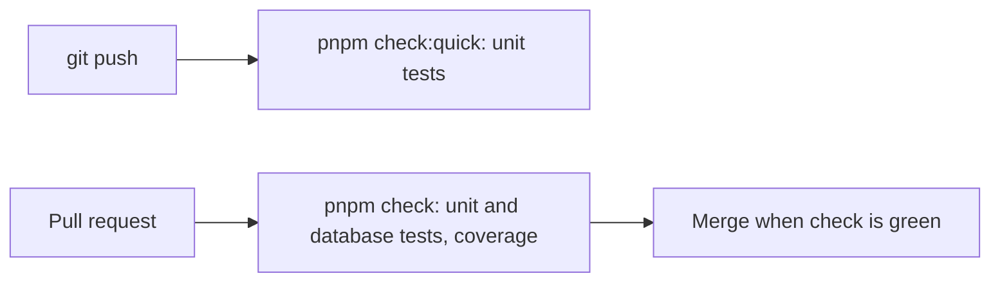

# Tests

## What it is

Every repo proves its code with tests that a machine runs, on the laptop before a push and in the pipeline before a merge. There are three layers:

| Layer   | What it proves                                                                                                                              | How it runs                                                                                              | From    |
| ------- | ------------------------------------------------------------------------------------------------------------------------------------------- | -------------------------------------------------------------------------------------------------------- | ------- |
| Unit    | That one function or one module does what it says                                                                                           | Vitest, in a `*.test.ts` file beside the code                                                            | Phase 1 |
| API     | That every endpoint answers right: success, each error, and the error's body                                                                | Vitest builds the app and sends it requests, on a real PostgreSQL                                        | Phase 4 |
| Browser | That a person can finish each critical path of a web app, and that each component of the design system works, with no accessibility finding | Playwright drives Chromium: through the stories of `@zigordev/ui`, and against the production-shaped app | Phase 6 |

Vitest is the test runner. Testcontainers starts the real PostgreSQL, and the real Kafka for a service that sends or reads events. [`@zigordev/test`](../../packages/test/README.md) holds the helpers that every service shares: the database for each test file, the Kafka broker with its signed-in user, and the harness that builds an app for its API tests.

## Why we have it, and what we would lose without it

Tests are what lets a pull request merge by itself when `check` is green. Without them, every change would wait for a person to try it, and a change that breaks something old would reach production unnoticed.

The API tests run on a real PostgreSQL because a stand-in for the database hides the bugs that matter most: a constraint, a transaction, a query that sorts differently.

## How it works here, on the laptop and in production

Two commands run the tests, and each says what it covers:

| Command             | Runs                                                                                                             | Who runs it                                                        |
| ------------------- | ---------------------------------------------------------------------------------------------------------------- | ------------------------------------------------------------------ |
| `pnpm check`        | Everything, with coverage against a floor of 90%                                                                 | You, before a push, and the pipeline                               |
| `pnpm check:quick`  | Everything that needs no container, without coverage, in about a minute                                          | The push hook, before every push                                   |
| `pnpm test:stories` | The design system's stories in Chromium, in light and in dark, with axe and with coverage against the same floor | You, after a change to a component, and the pipeline's Stories job |

A test that needs a container sits in a file named `*.db.test.ts`. Those files belong to a Vitest project of their own, named after the app or package with `:db` at the end, and that project's global setup starts the container. `check:quick` leaves out every project whose name ends in `:db`, so a push never waits for Docker.



One PostgreSQL container serves a whole run. Its template database is migrated once, and every test file gets its own copy of it in milliseconds. Test files run at the same time and never see each other's rows.

Nothing of this runs in production. The pipeline's Quality job runs `pnpm check` on GitHub's machines, which have Docker.

## How to use it, with one worked example

A test that needs the database, `src/features/notes/routes.db.test.ts`:

```ts
import { useTestDatabase } from '@zigordev/test/postgres';
import { useApp } from '@zigordev/test/app';

const database = useTestDatabase();
const server = useApp(() => buildApp({ config: testConfig(database.url), logger }));

it('lists no notes in a new database', async () => {
  const response = await server.app.inject({ method: 'GET', url: '/api/v1/notes' });

  expect(response.json()).toEqual({ items: [] });
});
```

The app's `vitest.db.config.ts` names the project `<app>:db` and points at the global setup that migrates the template. The [package's README](../../packages/test/README.md) shows both files.

To run one file, name it: `pnpm exec vitest run src/features/notes/routes.db.test.ts`.

## How to check that it works, and what to do when it does not

- `pnpm check` prints how long it took. The target is under 10 minutes.
- A database test that fails with `Could not find a working container runtime strategy` means Docker is not running. Start Docker Desktop and run it again.
- Coverage that falls under 90% fails `check`. The floor is never lowered: a test is added instead.
- A test is never skipped, and never made green by changing what it expects without a reason. A wrong test is fixed in a commit of its own that says why.
