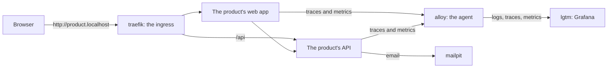

# The laptop platform

## What it is

The laptop platform is what lets a laptop run a product the way production runs it: in containers, behind one ingress, beside one telemetry agent. It has two parts.

| Part                | Where it lives                              | What it is                                                                      |
| ------------------- | ------------------------------------------- | ------------------------------------------------------------------------------- |
| The shared services | `platform`, as the bundle `@zigordev/stack` | Five containers that every product on the laptop shares                         |
| The product's side  | Each product, copied from the template      | Three compose files, and the scripts `local:up`, `local:down` and `local:reset` |

The shared services are these. An ingress is the one door that every request comes in through. A telemetry agent is the program that collects what the apps report about themselves.

| Service        | What it does                                                                                  | Runs in production too            |
| -------------- | --------------------------------------------------------------------------------------------- | --------------------------------- |
| `traefik`      | The ingress. It sends each address to its container, from the labels the container carries    | Yes                               |
| `docker-proxy` | A filtered door to Docker, through which the ingress and the agent see which containers exist | Yes                               |
| `alloy`        | The telemetry agent. It receives traces and metrics, and reads every container's log lines    | Yes                               |
| `lgtm`         | The local Grafana, with its stores for logs, traces and metrics                               | No. Production uses Grafana Cloud |
| `mailpit`      | The mail catcher. It shows every email an app sent on the laptop                              | No. Production uses Amazon SES    |



Everything has an address that ends in `.localhost`. Such a name always means this machine, in every browser and in `curl`, so nothing is added to a hosts file.

| Address                      | What opens                                                      |
| ---------------------------- | --------------------------------------------------------------- |
| `http://<product>.localhost` | The product: its web app, and its API under `/api`              |
| `http://grafana.localhost`   | Grafana, with every log line, trace and metric of every product |
| `http://mail.localhost`      | Every email that was sent on this laptop                        |
| `http://traefik.localhost`   | The routes the ingress knows, and why one is missing            |
| `http://alloy.localhost`     | The agent's own pages, and whether each of its parts is healthy |

[The page of `@zigordev/stack`](https://github.com/zigordev/platform/blob/main/stack/README.md) describes each shared service in full.

## Why we have it, and what we would lose without it

The third principle of the platform is that local mirrors production. A route, a health check, a limit or a log line that works on the laptop then works on the host, because it is the same container started from the same `compose.yaml`.

Without the shared services, each product would bring an ingress of its own. Two products could not run side by side on one laptop: both would want port 80, and their logs would land in two places.

Without telemetry on the laptop, a dashboard or an alert could only be tried in production, on real visitors.

Without one command that starts it all, running a product would be a list of steps in a document, and every laptop would do them a little differently.

## How it works here, on the laptop and in production

### One project that every product shares

The five containers form one Compose project named `platform`, whichever folder they are started from. A second start changes nothing, so two products share one set of services, and stopping a product never stops them.

They own two things that a product relies on by name:

| Name             | What it is                                                                                                                                                     |
| ---------------- | -------------------------------------------------------------------------------------------------------------------------------------------------------------- |
| `zigordev`       | The network that every app joins. On it, each service answers to its own name                                                                                  |
| `alloy:4318`     | Where an app sends its traces and metrics, over OTLP, the protocol of OpenTelemetry                                                                            |
| `127.0.0.1:4318` | The same port of the agent, published on the laptop itself, for an app run outside a container with `pnpm dev`. HTTP only, and from `@zigordev/stack` 1.1.0 on |

### What a product brings

A product describes itself in three files, and nowhere else. This is promise 7 of [the contract](the-platform.md).

| File                      | What it holds                                                                                               |
| ------------------------- | ----------------------------------------------------------------------------------------------------------- |
| `compose.yaml`            | The whole product as it runs everywhere: each service with its image, limits, health check and route labels |
| `compose.local.yaml`      | What differs on the laptop: how the images are built, and the address `<product>.localhost`                 |
| `compose.production.yaml` | What differs in production: the address, and that the deploy runs the jobs itself                           |

Each app says four things in `compose.yaml`, and gets four things back:

| The app says                       | With                                                      | What it gets                                            |
| ---------------------------------- | --------------------------------------------------------- | ------------------------------------------------------- |
| "I am on the shared network"       | `networks: [zigordev]`, and the network marked `external` | The ingress and the agent can reach it, and it them     |
| "Route this address to me"         | The labels `traefik.enable`, a router rule, and its port  | Requests for that address, once its health check passes |
| "This is my name"                  | Its service name, which is `<product>-<part>`             | Its log lines in Grafana under that name, with no setup |
| "Send my traces and metrics there" | `OTEL_EXPORTER_OTLP_ENDPOINT: http://alloy:4318`          | Its traces and metrics in Grafana                       |

The web app gets the product's whole address, and the API gets the same address under `/api`, so a browser talks to one origin. An app publishes no port. The only way in is the ingress.

Each app's container is boxed in the same way: a user that is not root, a read-only file system, no capability, no new privilege, an init process, 30 seconds to stop, and a memory and a CPU limit. In the template, the test `compose.test.ts` holds the files to these rules, and `zigordev contract` holds the running images to the first six promises of the contract.

A service that is not an app says what it is with a label of the platform, and the platform does the rest. [Record 0035](../adr/0035-labels-tell-the-platform-what-a-service-is.md), proposed on 2026-11-23, sets both labels. The template gets one of each with its notes API:

| Label                           | On                                                     | What the platform does with it                                                                                                                                                                 |
| ------------------------------- | ------------------------------------------------------ | ---------------------------------------------------------------------------------------------------------------------------------------------------------------------------------------------- |
| `com.zigordev.job: migrate`     | `<app>-migrate`, a one-shot job on the app's own image | On the laptop, the app waits for it with `depends_on`, so `pnpm local:up` migrates before the app starts. In production the deploy runs it once, before the new version, and stops if it fails |
| `com.zigordev.backup: postgres` | The product's PostgreSQL                               | The hourly backup on the host dumps every database in it, from inside the container                                                                                                            |

The dump runs inside the PostgreSQL container, so the container's memory limit is set higher than the database needs at rest, to leave room for it. `compose.production.yaml` resets the app's `depends_on` on the job with `depends_on: !reset []`, because there the deploy runs the job itself, once per version.

### Two ways to run a product

| Command                        | What runs                                                                                                                | When to use it                               |
| ------------------------------ | ------------------------------------------------------------------------------------------------------------------------ | -------------------------------------------- |
| `pnpm local:up`                | The shared services, then the whole product in containers, built from the working copy                                   | To see the product as production will run it |
| `pnpm dev web`, `pnpm dev api` | The one app being edited, on the laptop itself, with hot reload. The rest of the product keeps running in its containers | While writing code                           |
| `pnpm local:down`              | Stops and removes the product's containers. The shared services stay                                                     | When done                                    |
| `pnpm local:reset`             | The same, deletes the product's data, and starts it again                                                                | To start from seed data                      |

`pnpm local:up` is two steps in one script. `zigordev-stack up` starts the shared services and waits until each is healthy. `docker compose up --build --detach --wait` then builds the product's images, starts its containers, and returns when every one is healthy.

A product takes `@zigordev/stack` from npm, as a dev dependency. The first step therefore needs no clone of `platform`, and every product on the laptop starts the same five containers.

`pnpm dev <app>` runs the app named on the command line, found by its folder `apps/<product>-<app>`. The API runs under `node --watch`, which restarts it on a saved change, and the web app runs `next dev`, which shows a change on the next look at the page. Each app takes its dev settings from its committed `.env.development`, checked by the same schema as in its container. A dev process listens on `127.0.0.1` only, and calls itself version `dev`. [The template's README](../../template/README.md) has the details, and which telemetry a dev process sends.

### The laptop and production

The three services that run everywhere start from the same file on the host. [The platform](the-platform.md) lists the six things that differ between the two, and each of them is a setting. For this page two matter: on the laptop a request arrives at port 80 of the laptop itself, and the agent sends to the local Grafana. In production a request arrives through Cloudflare's tunnel, and the agent sends to Grafana Cloud. Production is built in phase 3.

## How to use it, with one worked example

The worked example is the product template in this repo, whose product name is `template`. It needs Docker running.

In the folder `template` of this repo, after `pnpm install` at the root:

```bash
pnpm local:up
```

It starts the shared services, or finds them running, pushes the dashboards and the alert rules, builds the template's two images, and returns when both containers are healthy. The first build takes a few minutes. Then:

| Open                                     | What you see                                                                                |
| ---------------------------------------- | ------------------------------------------------------------------------------------------- |
| `http://template.localhost`              | The page, which reads "Hello from template-api"                                             |
| `http://template.localhost/api/v1/hello` | The API's own answer, at the same address                                                   |
| `http://template.localhost/health`       | The web app's health, with the API as one of its parts                                      |
| `http://grafana.localhost`               | In Dashboards, folder `zigordev`, the dashboard App lists `template-api` and `template-web` |

To stop it, run `pnpm local:down` in the folder `template`. The shared services keep running for the next product.

To add an app to a product, give it a service in `compose.yaml` that says the four things above. This is the template's API, in full:

```yaml
template-api:
  image: ghcr.io/zigordev/template-api:${VERSION:-local}
  user: "1000:1000"
  init: true
  read_only: true
  cap_drop: [ALL]
  security_opt: [no-new-privileges:true]
  stop_grace_period: 30s
  mem_limit: 256m
  cpus: 1
  environment:
    PORT: "3000"
    OTEL_SERVICE_NAME: template-api
    OTEL_SERVICE_VERSION: ${VERSION:-local}
    OTEL_EXPORTER_OTLP_ENDPOINT: http://alloy:4318
  healthcheck:
    test: [CMD, wget, -q, -T, "4", -O, /dev/null, "http://127.0.0.1:3000/health"]
    interval: 10s
    timeout: 5s
    retries: 3
    start_period: 30s
    start_interval: 2s
  labels:
    traefik.enable: "true"
    traefik.http.services.template-api.loadbalancer.server.port: "3000"
  networks: [zigordev]
```

Its address is in `compose.local.yaml`, because it differs between the laptop and production:

```yaml
labels:
  traefik.http.routers.template-api.rule: Host(`template.localhost`) && PathPrefix(`/api`)
```

[The template's README](../../template/README.md) explains each line of both files.

## How to check that it works, and what to do when it does not

| Try this                                                                | What must happen                                                                  |
| ----------------------------------------------------------------------- | --------------------------------------------------------------------------------- |
| Run `pnpm local:up` in the folder `template`                            | It ends with every container healthy, the five shared ones and the template's two |
| Open `http://template.localhost`                                        | The page reads "Hello from template-api"                                          |
| Stop the API's container, and load the page again                       | The page still renders, and says that the API does not answer                     |
| Open `http://nothing.localhost`                                         | The ingress answers 404, because no container asked for that address              |
| In Grafana's Explore, pick Loki and run `{service_name="template-api"}` | The API's log lines show, each one as JSON                                        |
| Run `pnpm check:contract` in the folder `template`                      | Both apps keep promises 1 to 6                                                    |
| Run `pnpm local:down` in the folder `template`                          | The two containers are gone, and `http://grafana.localhost` still opens           |

| What you see                                                          | What it means                                                                                                                  | What to do                                                                                                 |
| --------------------------------------------------------------------- | ------------------------------------------------------------------------------------------------------------------------------ | ---------------------------------------------------------------------------------------------------------- |
| `Cannot connect to the Docker daemon`                                 | Docker is not running                                                                                                          | Start Docker Desktop                                                                                       |
| `zigordev-stack: command not found`                                   | The dependencies are not installed, so the command of `@zigordev/stack` is missing                                             | Run `pnpm install` at the root of the repo                                                                 |
| `network zigordev declared as external, but could not be found`       | The product was started by hand, with `docker compose`, while the shared services were not running                             | Start it with `pnpm local:up`, which starts them first                                                     |
| `Bind for 127.0.0.1:80 failed: port is already allocated`             | Another program on the laptop holds port 80                                                                                    | Find it with `lsof -nP -iTCP:80 -sTCP:LISTEN`, and stop it                                                 |
| `Bind for 127.0.0.1:4318 failed: port is already allocated`           | Another program on the laptop holds the agent's port                                                                           | Find it with `lsof -nP -iTCP:4318 -sTCP:LISTEN`, and stop it                                               |
| The dev API writes an error line a minute about sending its telemetry | The agent's port is not there: the shared services are stopped, or a product with an older `@zigordev/stack` started them last | Run `pnpm local:up` in the template once. It starts the shared services from 1.1.0, which publish the port |
| The start waits, and ends with a container that is `unhealthy`        | The app did not pass its health check                                                                                          | `docker logs <container>` shows why. An app that misses a setting names it there, and stops with code 1    |
| The product's address answers 404 for a moment, right after a start   | The ingress has not seen the new containers yet. It needs a few seconds                                                        | Load the address again                                                                                     |
| The ingress keeps answering 404 for the product's address             | The app is not on the network `zigordev`, has no `traefik.enable`, or is not healthy                                           | `http://traefik.localhost` lists the routes the ingress knows                                              |
| The page loads, and says that the API does not answer                 | The web app cannot reach the API, or the API is down                                                                           | `docker ps` shows whether the API runs. `API_URL` in `compose.yaml` names where the web app looks          |
| An app's log lines do not show in Grafana                             | The app is not on the network `zigordev`, so the agent does not read it                                                        | Add the network to the app's service                                                                       |
| An app's traces or metrics do not show                                | The app sends them somewhere else, or nowhere                                                                                  | Set `OTEL_EXPORTER_OTLP_ENDPOINT` to `http://alloy:4318`. [Telemetry](telemetry.md) has the other cases    |
