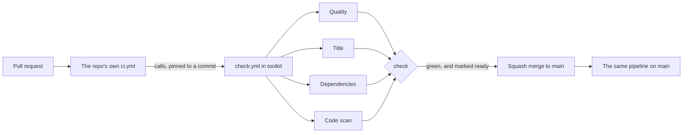

# The pipeline

## What it is

The pipeline is the set of checks that every change passes on GitHub: on its pull request, before it can reach `main`, and once more on `main` after the merge. GitHub Actions runs it.

It is written once, in `toolkit`, as the file `.github/workflows/check.yml`. GitHub calls such a file a reusable workflow, because the workflow of another repo can call it. Every repo's own workflow is a short caller, and holds no check of its own.

| Job          | What it checks                                                                        | Runs on                            |
| ------------ | ------------------------------------------------------------------------------------- | ---------------------------------- |
| Quality      | `pnpm check`, exactly as on a laptop: lint, build, type check and tests with coverage | Every pull request and every merge |
| Title        | The pull request's title is a Conventional Commit                                     | Pull requests                      |
| Dependencies | No package the pull request adds has a known flaw                                     | Pull requests                      |
| Code scan    | CodeQL finds no vulnerable pattern in our own code or in the workflows                | Every pull request and every merge |
| `check`      | Every job above passed. It is the gate, and the one check that `main` requires        | Every pull request and every merge |

The gate sits in the caller, not in `check.yml`. It is the same few lines in every repo.

## Why we have it, and what we would lose without it

Without one shared pipeline, each repo would write its own. A check added in one repo would be missing in the others, and nobody would notice until it mattered.

Without the gate, the rule on `main` would have to name every job. A new job would then mean a change to the settings of every repo. With the gate, the rule names `check` and nothing else, and the jobs behind it can change in one place.

Without `pnpm check` as the heart of it, GitHub would run something the laptop does not. A change would pass on the laptop and fail on GitHub, and the reason would be the setup, not the change.

## How it works here, on the laptop and in production



On the laptop, `pnpm check` runs what the Quality job runs, and the push hook runs `pnpm check:quick` before a branch leaves. The other three jobs need GitHub: they read the pull request, GitHub's list of known flaws, and GitHub's code scanner.

Nothing of the pipeline runs on the host. In a repo that publishes packages, the release follows a green `check` on `main`. In a product, the deploy will follow it, from phase 3.

### The caller

A repo calls the pipeline by its repo, its file and one commit:

```yaml
uses: zigordev/toolkit/.github/workflows/check.yml@59bfb39019ea676693dde99c0b0a01dc600cad8a # v1.1.0
```

The commit is the one that a version tag of `toolkit` points at, and the version stands beside it. A repo therefore runs the pipeline of one known version, and a change to `check.yml` reaches it as an update, like any dependency. Renovate proposes that update together with the new `@zigordev/*` packages, in one pull request. [Dependency updates](dependency-updates.md) says when it merges.

`toolkit` is the one exception. Its caller names the file in the same repo, so a pull request that changes `check.yml` is checked by its own change.

### When it runs

The caller starts on four events of a pull request: it was opened, its commits changed, it was reopened, or its title or description was edited. The last one is there because the pipeline reads both: the Title job reads the title, and the Quality job refuses an attribution line in either.

A newer run of the same pull request cancels the older one. Editing the description while a run is in progress therefore cancels that run, and its `check` shows as failed until the new run ends.

On `main`, the caller starts on every push, which is every merge. A run in progress there is never cancelled, and the run of a second merge waits for it.

### What each job may do

`check.yml` starts with no permission at all, and each job asks for the least it needs. A reusable workflow can never get more than the job that calls it gives, so the caller grants two: `contents: read`, to read the repo, and `security-events: write`, so the code scan can store what it finds. Every action is pinned to a commit, and no value of a pull request is ever placed inside a shell command.

### What a repo has to bring

| The job      | Needs from the repo                                                                       |
| ------------ | ----------------------------------------------------------------------------------------- |
| Quality      | `mise.toml` with the pinned tools, the lockfile, and the script `check` in `package.json` |
| Title        | `@commitlint/cli` among the dev dependencies, and the shared `.commitlintrc.json`         |
| Dependencies | The dependency graph, switched on in the repo's settings. It is off in a new repo         |
| Code scan    | Nothing. It scans the JavaScript, the TypeScript and the workflows it finds               |

## How to use it, with one worked example

The worked example is the whole `.github/workflows/ci.yml` of `platform`, as it was on 2026-11-22. It is the model for every repo but `toolkit`:

```yaml
name: CI

on:
  pull_request:
    types: [opened, edited, synchronize, reopened]
  push:
    branches: [main]

permissions: {}

concurrency:
  group: ci-${{ github.ref }}
  cancel-in-progress: ${{ github.event_name == 'pull_request' }}

jobs:
  pipeline:
    name: Pipeline
    uses: zigordev/toolkit/.github/workflows/check.yml@59bfb39019ea676693dde99c0b0a01dc600cad8a # v1.1.0
    permissions:
      contents: read
      security-events: write

  check:
    name: check
    needs: [pipeline]
    if: always()
    runs-on: ubuntu-latest
    timeout-minutes: 5
    permissions: {}
    steps:
      - name: Pass only when every job passed
        env:
          RESULT: ${{ needs.pipeline.result }}
        run: |
          echo "The pipeline ended with: $RESULT"
          test "$RESULT" = "success"
```

A new repo takes it in three steps:

1. Copy the file, and put the newest version in the `uses` line. This command prints the commit of a version:

   ```bash
   git ls-remote https://github.com/zigordev/toolkit refs/tags/v1.2.0
   ```

2. The owner switches on the dependency graph, and makes `check` the one required check on `main`. Settings wait for the owner.
3. Open the first pull request. The `actions` rule of `zigordev check` accepts the `uses` line as it is, because it is a commit with its version beside it.

A repo that publishes packages adds a third job, the release. [Packages](packages.md) and [this repo's caller](../../.github/workflows/ci.yml) show it.

To add a check for every repo, add a job to `check.yml` in `toolkit`. It reaches the others with the next version. A check that a laptop can run belongs inside `pnpm check` instead, where the Quality job already runs it.

## How to check that it works, and what to do when it does not

| Try this                                         | What must happen                                                                 |
| ------------------------------------------------ | -------------------------------------------------------------------------------- |
| Open a draft pull request                        | Four jobs and `check` appear on it, and `check` turns green after the other four |
| Push a file that holds a comment                 | Quality turns red, `check` turns red, and the pull request cannot merge          |
| Title a pull request `added things`              | Title turns red                                                                  |
| Add a package that has a known flaw              | Dependencies turns red, and its summary names the package and the flaw           |
| Mark a green pull request ready, with auto-merge | It merges by itself, as one commit, and the same pipeline starts on `main`       |

| What you see                                                              | What it means                                                                         | What to do                                                                                                              |
| ------------------------------------------------------------------------- | ------------------------------------------------------------------------------------- | ----------------------------------------------------------------------------------------------------------------------- |
| `check` is red, and every job of the newest run is green or still running | The red `check` belongs to an older run that a newer one cancelled                    | Wait for the newest run. The link of each check names its run                                                           |
| Quality is red on GitHub and green on the laptop                          | The laptop runs other tool versions, or a test leans on something only the laptop has | Run `mise install` and `pnpm install`, then `pnpm check`. If it still passes, read the job's log for the test           |
| Dependencies fails with a 403 in a new repo                               | The dependency graph is off                                                           | The owner switches it on in the repo's settings                                                                         |
| Dependencies names a package that the pull request did not add by name    | Another package brought it in. In a new repo that is katex, which markdownlint brings | `pnpm why <name> -r` shows what brings it in. For katex, add `katex: 0.19.1` under `overrides` in `pnpm-workspace.yaml` |
| `zigordev check` refuses the `uses` line                                  | It is not a 40-character commit with its version beside it                            | Take the commit from the command above, and write the version after `#`                                                 |

[How toolkit reaches the other repos](../cloud-first-deploy.md) lists every other case, the release included.
