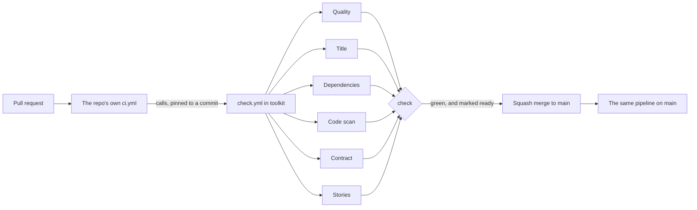

# The pipeline

## What it is

The pipeline is the set of checks that every change passes on GitHub: on its pull request, before it can reach `main`, and once more on `main` after the merge. GitHub Actions runs it.

It is written once, in `toolkit`, as the file `.github/workflows/check.yml`. GitHub calls such a file a reusable workflow, because the workflow of another repo can call it. Every repo's own workflow is a short caller, and holds no check of its own.

| Job          | What it checks                                                                                                                                                         | Runs on                                                          |
| ------------ | ---------------------------------------------------------------------------------------------------------------------------------------------------------------------- | ---------------------------------------------------------------- |
| Quality      | `pnpm check`, exactly as on a laptop: lint, build, type check and tests with coverage                                                                                  | Every pull request and every merge                               |
| Title        | The pull request's title is a Conventional Commit                                                                                                                      | Pull requests                                                    |
| Dependencies | No package the pull request adds has a known flaw                                                                                                                      | Pull requests                                                    |
| Code scan    | CodeQL finds no vulnerable pattern in our own code or in the workflows                                                                                                 | Every pull request and every merge                               |
| Contract     | Each app of a product keeps promises 1 to 7 of [the contract](the-platform.md), on its built images, and its compose files keep the rules of the deploy and the backup | Every pull request and every merge, in a repo that has a product |
| Stories      | The design system's stories pass as browser tests in Chromium, in light and in dark, with no accessibility finding, and cover 90% of its code                          | Every pull request and every merge, in a repo that has stories   |
| `check`      | Every job above passed. It is the gate, and the one check that `main` requires                                                                                         | Every pull request and every merge                               |

The gate sits in the caller, not in `check.yml`. It is the same few lines in every repo.

## Why we have it, and what we would lose without it

Without one shared pipeline, each repo would write its own. A check added in one repo would be missing in the others, and nobody would notice until it mattered.

Without the gate, the rule on `main` would have to name every job. A new job would then mean a change to the settings of every repo. With the gate, the rule names `check` and nothing else, and the jobs behind it can change in one place.

Without `pnpm check` as the heart of it, GitHub would run something the laptop does not. A change would pass on the laptop and fail on GitHub, and the reason would be the setup, not the change.

## How it works here, on the laptop and in production



On the laptop, `pnpm check` runs what the Quality job runs, and the push hook runs `pnpm check:quick` before a branch leaves. In a product's folder, `pnpm check:contract` runs what the Contract job runs, and it needs Docker running. The other three jobs need GitHub: they read the pull request, GitHub's list of known flaws, and GitHub's code scanner.

The Contract job has a machine of its own, one of GitHub's arm64 runners, because an app's image is built for arm64 only. It builds the product's images from the pull request's code, starts them, and runs `zigordev contract`. [The developer setup](../../packages/dev/README.md) says what that command does for each promise. A repo without a product does not name a product folder, and the job is skipped there.

The Stories job runs inside the official Playwright image, `mcr.microsoft.com/playwright`, on the same Ubuntu as every other job and pinned by its digest. The image already holds the browsers, so no run waits for a browser download, which hung November's pipeline for 30 minutes on 2026-11-20. Its Playwright version is the one the workspace installs, and a test of `@zigordev/ui` fails when the two differ. On the laptop, `pnpm test:stories` runs the same, after `pnpm exec playwright install chromium` once. A repo without a design system leaves `stories` out, and the job is skipped there.

Nothing of the pipeline runs on the host. In a repo that publishes packages, the release follows a green `check` on `main`. In a product, two more reusable workflows follow it: `publish.yml` builds and attests the images, and `deploy.yml` asks the host to run them. [Delivery](delivery.md) explains both. They are files of their own, apart from `check.yml`, because GitHub checks every job of a called workflow against the caller's permissions when the run starts, even a job that would be skipped, and a pull request must never be granted the right to push an image.

### The caller

A repo calls the pipeline by its repo, its file and one commit:

```yaml
uses: zigordev/toolkit/.github/workflows/check.yml@59bfb39019ea676693dde99c0b0a01dc600cad8a # v1.1.0
```

The commit is the one that a version tag of `toolkit` points at, and the version stands beside it. A repo therefore runs the pipeline of one known version, and a change to `check.yml` reaches it as an update, like any dependency. Renovate proposes that update together with the new `@zigordev/*` packages, in one pull request. [Dependency updates](dependency-updates.md) says when it merges.

`toolkit` is the one exception. Its caller names the file in the same repo, so a pull request that changes `check.yml` is checked by its own change.

### When it runs

The caller starts on four events of a pull request: it was opened, its commits changed, it was reopened, or its title or description was edited. The last one is there because the pipeline reads both: the Title job reads the title, and the Quality job refuses an attribution line in either.

A newer run of the same pull request cancels the older one. Editing the description while a run is in progress therefore cancels that run, and its `check` shows as failed until the new run ends.

On `main`, the caller starts on every push, which is every merge. A run in progress there is never cancelled, and the run of a second merge waits for it.

### What each job may do

`check.yml` starts with no permission at all, and each job asks for the least it needs. A reusable workflow can never get more than the job that calls it gives, so the caller grants two: `contents: read`, to read the repo, and `security-events: write`, so the code scan can store what it finds. Every action is pinned to a commit, and no value of a pull request is ever placed inside a shell command.

### The machines it runs on

Every job names the machine it runs on exactly: `ubuntu-26.04`, and `ubuntu-26.04-arm` for the Contract job, because an app's image is built for arm64. No job names `ubuntu-latest`.

GitHub moves `ubuntu-latest` by itself, with no pull request. On 2026-11-23 the jobs on it already ran on Ubuntu 26.04, while GitHub's own list still gave the label as 24.04. A named version moves only through Renovate's pull request, and as a major version that waits a month and for a person. The host of phase 3 runs the same version, so a build and the machine that runs it share one system. [Record 0034](../adr/0034-the-pipeline-and-the-host-run-one-named-ubuntu-lts.md) holds the decision, and `packages/dev/src/pipeline.test.ts` holds every job of `toolkit` to its label.

A repo's own jobs, such as the gate in its caller, name their machine the same way.

### What a repo has to bring

| The job      | Needs from the repo                                                                                                               |
| ------------ | --------------------------------------------------------------------------------------------------------------------------------- |
| Quality      | `mise.toml` with the pinned tools, the lockfile, and the script `check` in `package.json`                                         |
| Title        | `@commitlint/cli` among the dev dependencies, and the shared `.commitlintrc.json`                                                 |
| Dependencies | The dependency graph, switched on in the repo's settings. It is off in a new repo                                                 |
| Code scan    | Nothing. It scans the JavaScript, the TypeScript and the workflows it finds                                                       |
| Contract     | The folder of its product, named in the caller. In that folder: `compose.yaml`, and the script `check:contract` in `package.json` |
| Stories      | `stories: true` in the caller, and the script `test:stories` in `package.json`, which runs the stories with coverage              |

## How to use it, with one worked example

The worked example is the whole `.github/workflows/ci.yml` of a repo that calls the pipeline, in the shape that `platform` has. It is the model for every repo but `toolkit`:

```yaml
name: CI

on:
  pull_request:
    types: [opened, edited, synchronize, reopened, labeled, unlabeled]
  push:
    branches: [main]

permissions: {}

concurrency:
  group: ci-${{ github.ref }}
  cancel-in-progress: ${{ github.event_name == 'pull_request' }}

jobs:
  pipeline:
    name: Pipeline
    uses: zigordev/toolkit/.github/workflows/check.yml@59bfb39019ea676693dde99c0b0a01dc600cad8a # v1.1.0
    permissions:
      contents: read
      security-events: write

  check:
    name: check
    needs: [pipeline]
    if: always()
    runs-on: ubuntu-26.04
    timeout-minutes: 5
    permissions: {}
    steps:
      - name: Pass only when every job passed
        env:
          RESULT: ${{ needs.pipeline.result }}
        run: |
          echo "The pipeline ended with: $RESULT"
          test "$RESULT" = "success"
```

The pull request runs the pipeline again when a label is added or removed, because the `migrations` rule of `zigordev check` reads one: a migration that deletes data passes only with the owner's label `destructive-migration`.

A new repo takes it in three steps:

1. Copy the file, and put the newest version in the `uses` line. This command prints the commit of a version:

   ```bash
   git ls-remote https://github.com/zigordev/toolkit refs/tags/v1.2.0
   ```

2. The owner switches on the dependency graph, and makes `check` the one required check on `main`. Settings wait for the owner.
3. Open the first pull request. The `actions` rule of `zigordev check` accepts the `uses` line as it is, because it is a commit with its version beside it.

A repo that publishes packages adds a third job, the release. [Packages](packages.md) and [this repo's caller](../../.github/workflows/ci.yml) show it.

A repo that holds a product names the product's folder, with two more lines under `uses`. A product repo's folder is the repo itself:

```yaml
with:
  product-folder: .
```

`toolkit` names `template`, where the product template lives. The script that the job runs builds the images and runs the command. A product with a database or a Kafka user gives the run throwaway passwords, because the contract starts the product from `compose.yaml` alone, where the passwords of production are left empty:

```json
"check:contract": "docker compose --file compose.yaml --file compose.local.yaml build && POSTGRES_PASSWORD=contract-only TEMPLATE_API_DATABASE_PASSWORD=contract-only KAFKA_PASSWORD=contract-only zigordev contract"
```

To add a check for every repo, add a job to `check.yml` in `toolkit`. It reaches the others with the next version. A check that a laptop can run belongs inside `pnpm check` instead, where the Quality job already runs it.

## How to check that it works, and what to do when it does not

| Try this                                         | What must happen                                                                                               |
| ------------------------------------------------ | -------------------------------------------------------------------------------------------------------------- |
| Open a draft pull request                        | Four jobs and `check` appear on it, or five in a repo with a product, and `check` turns green after the others |
| Push a file that holds a comment                 | Quality turns red, `check` turns red, and the pull request cannot merge                                        |
| Title a pull request `added things`              | Title turns red                                                                                                |
| Add a package that has a known flaw              | Dependencies turns red, and its summary names the package and the flaw                                         |
| Make an app print a line of plain text           | Contract turns red, and its log says which app broke promise 4, and quotes the line                            |
| Mark a green pull request ready, with auto-merge | It merges by itself, as one commit, and the same pipeline starts on `main`                                     |

| What you see                                                              | What it means                                                                         | What to do                                                                                                                        |
| ------------------------------------------------------------------------- | ------------------------------------------------------------------------------------- | --------------------------------------------------------------------------------------------------------------------------------- |
| `check` is red, and every job of the newest run is green or still running | The red `check` belongs to an older run that a newer one cancelled                    | Wait for the newest run. The link of each check names its run                                                                     |
| Quality is red on GitHub and green on the laptop                          | The laptop runs other tool versions, or a test leans on something only the laptop has | Run `mise install` and `pnpm install`, then `pnpm check`. If it still passes, read the job's log for the test                     |
| Dependencies fails with a 403 in a new repo                               | The dependency graph is off                                                           | The owner switches it on in the repo's settings                                                                                   |
| Contract is red, and its log has a line that says `broken`                | An app does not keep one of the first six promises                                    | The line names the app, the promise and what was seen. `pnpm check:contract` in the product's folder shows the same on the laptop |
| Contract is red before any line says `kept` or `broken`                   | An image did not build, or the product did not start and get healthy                  | The lines above the failure name the step. `docker compose --file compose.yaml --file compose.local.yaml build` repeats the build |
| Dependencies names a package that the pull request did not add by name    | Another package brought it in. In a new repo that is katex, which markdownlint brings | `pnpm why <name> -r` shows what brings it in. For katex, add `katex: 0.19.1` under `overrides` in `pnpm-workspace.yaml`           |
| `zigordev check` refuses the `uses` line                                  | It is not a 40-character commit with its version beside it                            | Take the commit from the command above, and write the version after `#`                                                           |

[How toolkit reaches the other repos](../cloud-first-deploy.md) lists every other case, the release included.
