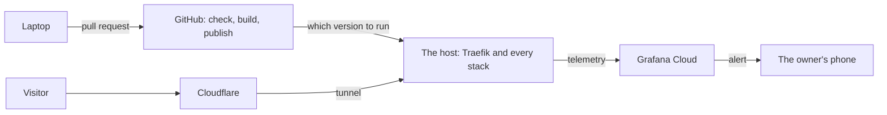

# The platform

This page describes the whole platform as it is meant to be. It is built in eight phases, and the [reading order](README.md) says which pieces exist yet.

## What it is

Three shared repos, one repo per product, and one small AWS host that runs the same containers as the laptop.

A change leaves the laptop as a pull request. GitHub checks it, builds it and tells the host which version to run. Visitors only ever meet Cloudflare, and the host opens no port to the internet.

| Repo                                          | What it holds                                                                                                                         | What comes out of it                                                                                                                             |
| --------------------------------------------- | ------------------------------------------------------------------------------------------------------------------------------------- | ------------------------------------------------------------------------------------------------------------------------------------------------ |
| `toolkit`                                     | The shared packages, the design system with Storybook, the product template, the shared pipelines, the handbook and the session rules | npm packages under one version, on every merge that changes one                                                                                  |
| `platform`                                    | The infrastructure, the shared services, the host setup, the dashboards and alerts, the backups and the runbooks                      | Changes to AWS, Cloudflare, GitHub and Grafana, applied after the owner's approval, and the shared services for the laptop as a versioned bundle |
| `notifications`                               | The email service and its client package                                                                                              | The service, deployed on every green merge like a product, and its client on npm                                                                 |
| One per product: `cv`, `gpool`, `trading-bot` | That product's API, web app, compose files, flags and docs                                                                            | The product, deployed on every green merge                                                                                                       |

Only `platform` can change infrastructure. A product repo can do one thing in AWS: ask the host to run a version of itself.

## Why we have it, and what we would lose without it

The rebuild of November 2026 chose good tools and lost its time between them: in hops across repos, in release steps, and in rules that only prose enforced. Each lesson became a rule of this platform.

| Lesson                                       | The rule now                                                                                                                                                        |
| -------------------------------------------- | ------------------------------------------------------------------------------------------------------------------------------------------------------------------- |
| A shared change crossed four repos           | Shared code lives in one repo, `toolkit`. The product template runs on the packages of the same checkout, so the pull request that changes a package also proves it |
| The cloud half came last                     | The cloud platform is built third, not last, and the notifications service goes through it as soon as it exists                                                     |
| Rules lived in prose                         | A rule a machine can check becomes a check. Prose keeps only the rest                                                                                               |
| Releasing was a ceremony                     | Products deploy from `main` with no release step. Packages publish from `main` by themselves                                                                        |
| Our own packages needed a token              | Packages go to the public npm registry, which installs without one                                                                                                  |
| Settings were made by hand                   | AWS, Cloudflare, GitHub and Grafana settings are code, and a weekly check alerts when reality differs                                                               |
| The same job was done several ways           | One product template to start from, one required check with the same name everywhere, and a conformance check                                                       |
| Merging surprised us                         | One merge policy, written once and enforced by the same ruleset in every repo                                                                                       |
| The newest version of everything broke tools | Stable releases only. A new major version waits a month and arrives as its own task                                                                                 |
| Apps leaned on shared services               | Each product owns its database and its flags. One shared service remains, notifications, and products keep working without it                                       |
| Browser tests left CI                        | They run in CI again, in an image that already holds the browsers                                                                                                   |

## How it works here, on the laptop and in production

### Twelve principles

When two tools could do a job, these pick one.

1. **Keep it simple.** Every tool has to earn its place, and one tool does each job.
2. **Same thing, same way.** A command, a file, a name or an error looks identical in every repo, on the laptop, in the hooks and in CI.
3. **Local mirrors production.** The laptop runs the same containers, the same compose file and the same telemetry. The differences are few and written down.
4. **Rules are checks.** What a machine can verify is verified by a hook, a lint rule or CI.
5. **Thin slices, end to end.** A capability is done when the product template proves it in CI.
6. **Each product owns its data.** A product is one self-contained stack with its own database. Products and services talk over HTTP contracts only.
7. **Trunk-based.** Small changes go to `main`, behind a flag while unfinished. `main` is always deployable, and a green merge deploys.
8. **Everything is code.** Infrastructure, GitHub settings, dashboards, alerts and flags live in git and change through pull requests.
9. **Documented to teach.** Every piece says what it is, why it exists and how to use it, in Markdown beside the code.
10. **Free first, cost visible.** A free tier wins when it is good enough. Every paid step has a price and a trigger.
11. **Boring by default.** Stable, widely used tools. New major versions wait.
12. **Secure by default.** No open ports, no stored cloud keys, least privilege, pinned and attested dependencies.

### One name per thing

| Thing                         | Rule                                                                                                 | Example                                                 |
| ----------------------------- | ---------------------------------------------------------------------------------------------------- | ------------------------------------------------------- |
| App                           | `<product>-<part>`: the same in its folder, package, compose service, image, telemetry and dashboard | `gpool-api`, `gpool-web`                                |
| Address                       | `<product>.zigordev.com` in production, `<product>.localhost` on the laptop                          | `gpool.zigordev.com`                                    |
| API                           | Under `/api/v1/` on the product's own address, so web and API share one origin                       | `gpool.zigordev.com/api/v1/pools`                       |
| Image                         | `ghcr.io/zigordev/<app>`, built for arm64 and tagged with its commit                                 | `ghcr.io/zigordev/gpool-api`                            |
| Package                       | `@zigordev/<name>`, on the public npm registry, unlicensed                                           | `@zigordev/otel`                                        |
| Scripts                       | The same names in every repo                                                                         | `dev`, `check`, `local:up`, `local:down`, `local:reset` |
| Branch                        | `<type>/<short-summary>`                                                                             | `fix/login-redirect`                                    |
| Commit and pull request title | Conventional Commits                                                                                 | `feat(api): add pool invitations`                       |

### The contract every app keeps

Any app runs on the platform if it keeps twelve promises, whatever language it is written in. TypeScript apps get most of them from the shared packages.

| #   | The app promises to                                                                                                       | Why                                                                               |
| --- | ------------------------------------------------------------------------------------------------------------------------- | --------------------------------------------------------------------------------- |
| 1   | Ship as a container image for arm64 that runs as a non-root user                                                          | The host and the laptop are both arm64, and a broken app must not own the machine |
| 2   | Read all its settings from environment variables, checked once at start                                                   | The same image runs everywhere, and a missing setting fails at once               |
| 3   | Listen on the port named in `PORT` and answer `GET /health`                                                               | The ingress, the deploy and the monitors all ask the same question                |
| 4   | Write its logs as JSON lines to stdout, with no personal data                                                             | One agent collects every app's logs the same way                                  |
| 5   | Send traces and metrics over OTLP to the address it is given, under its own name                                          | Every language has an OpenTelemetry library                                       |
| 6   | Stop cleanly within 30 seconds of a SIGTERM                                                                               | A deploy never cuts a request in half                                             |
| 7   | Describe itself in `compose.yaml`: health check, memory and CPU limit, route and data stores                              | Nothing about an app is configured anywhere else                                  |
| 8   | Keep state only in the data stores it declares                                                                            | The backup knows exactly what to save                                             |
| 9   | Change its database only forward, in steps the previous version can live with                                             | For a moment, a deploy runs the old and the new version side by side              |
| 10  | Talk to other apps over HTTP with a generated client, or with events over the broker, and keep working when they are down | No app can take another one down                                                  |
| 11  | Use one name everywhere: `<product>-<part>`                                                                               | Logs, dashboards and alerts line up without a mapping                             |
| 12  | Explain itself in a README and the four standard docs                                                                     | A reader learns what it is and how to run it                                      |

The command `zigordev contract` is the contract test: it starts a product's built images and checks promises 1 to 6 on each app. It checks promise 7 as far as the deploy and the backup depend on it: the rules of the compose files that [Delivery](delivery.md) lists, and that each app the ingress routes drains before it stops. [The developer setup](../../packages/dev/README.md) says what it does for each promise, and [the pipeline](the-pipeline.md) runs it on every pull request of a repo that has a product.

### The laptop and production, side by side

There are two environments, with no staging between them. Six things differ, and each one is a setting, never different code.

| Thing                                                                                          | On the laptop                                        | In production                                                 |
| ---------------------------------------------------------------------------------------------- | ---------------------------------------------------- | ------------------------------------------------------------- |
| App containers, compose file, database, flags, routing, telemetry agent, dashboards and alerts | The same                                             | The same                                                      |
| Address                                                                                        | `http://<product>.localhost`                         | `https://<product>.zigordev.com`, through Cloudflare's tunnel |
| Telemetry store                                                                                | A local Grafana container, at `grafana.localhost`    | Grafana Cloud, in an EU region                                |
| Email                                                                                          | Mailpit catches every message, at `mail.localhost`   | Amazon SES delivers it                                        |
| Secrets                                                                                        | Development values, generated into an untracked file | AWS Parameter Store                                           |
| Backups                                                                                        | The same script, into a local folder                 | Into S3                                                       |
| Data                                                                                           | Seed data                                            | Real data                                                     |

A product runs on the laptop in two ways, with the same two commands in every repo. `pnpm local:up` starts the whole product in containers, exactly as production runs it. `pnpm dev` runs the one app being edited on the laptop itself, with hot reload.

## How to use it, with one worked example

Every change travels the same way, in every repo:

1. One working branch, alive for hours, holding one concern.
2. A draft pull request. Marking it ready means: merge it when the check is green.
3. One required check, named `check`, which runs what `pnpm check` runs on the laptop.
4. A squash merge. The pull request's title becomes the commit.
5. A delivery. A product's merge deploys it. A `toolkit` merge that changes a package publishes all of them, and Renovate carries the new version to each product.

Take a fix to a shared package as the example. The fix and its test go into one pull request in `toolkit`. The product template in the same checkout runs on the fixed package, so that pull request proves the fix. Once it merges, the package is published, and Renovate opens an update in each product, which merges and deploys when its own check is green. Nobody copies anything, and nobody releases anything by hand.

Four kinds of change wait for the owner: an infrastructure change, a migration that deletes data, a tool, library or service that [the tool list](tools.md) does not hold yet, and a new major version of a dependency.

## How to check that it works, and what to do when it does not

The platform counts as done when all ten targets hold.

| Measure                                                   | Target                                                     | How it is checked                                    |
| --------------------------------------------------------- | ---------------------------------------------------------- | ---------------------------------------------------- |
| A merge reaches production                                | In under 10 minutes                                        | The pipeline's own timing, on the platform dashboard |
| The full check on the laptop                              | In under 10 minutes                                        | `pnpm check` prints its time                         |
| Manual steps in a deploy                                  | None                                                       | The pipeline runs from merge to live by itself       |
| A failed deploy                                           | Rolls back by itself, with no failed request               | The rollback drill                                   |
| A new product, from the template to running on the laptop | In under 1 hour, with no change to `toolkit` or `platform` | Phase 7                                              |
| Data lost in the worst case                               | At most 1 hour                                             | The alert on the age of the newest dump              |
| The host, rebuilt from nothing with every app running     | Within 1 hour                                              | The rebuild drill                                    |
| The newest backup                                         | Restored and checked every month                           | The restore test's metric                            |
| Every rule                                                | Names the check that enforces it                           | The table in the core rules                          |
| The monthly bill                                          | Within the budget for its size                             | The budget alarm                                     |

When a check is red, the change goes back to its author. When `main` is red, it is fixed or reverted before any other work. A version that fails its health gate never receives traffic, and one that answers wrongly from outside is rolled back.
