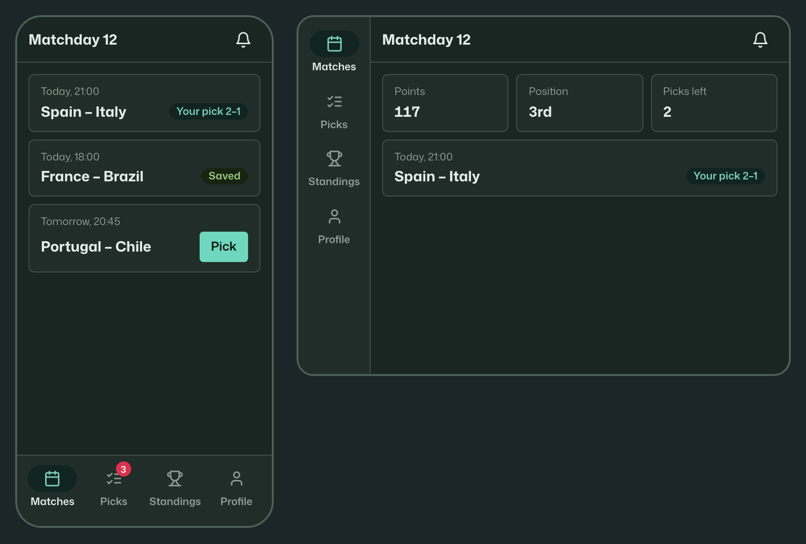
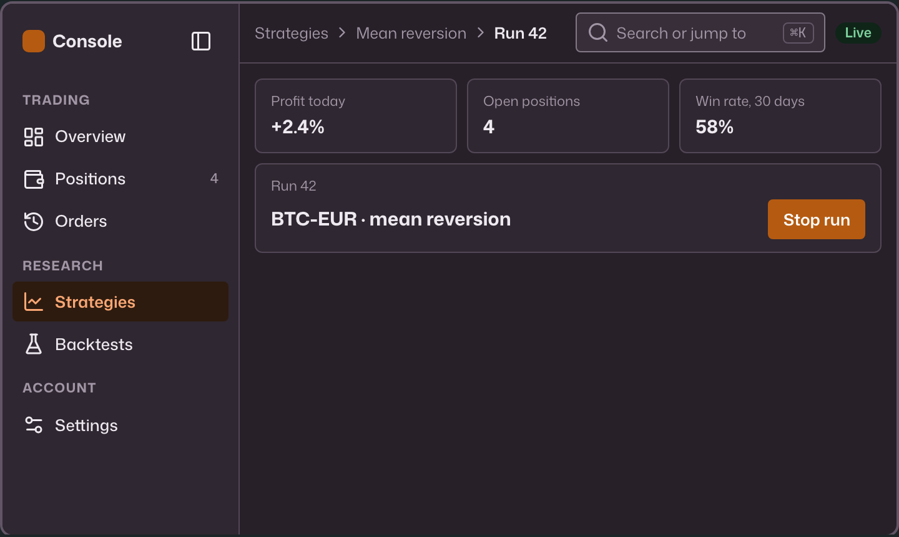
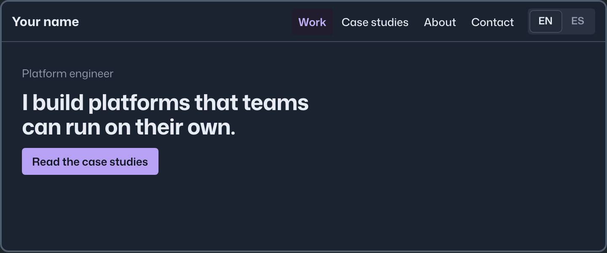

# The product look

This page holds the look of every product's main content: the pages inside the navigation. The owner chose it on 2026-11-27, and [record 0068](../adr/0068-every-product-follows-one-look-for-its-main-content.md) keeps the decision. The pictures are the reference, and the patterns below say how to draw them with the design system's tokens.

## What it is

The look comes from the three mockups of the navigation plan, drawn in each product's colours. The owner said of them: "exactly the look I want to keep once we create the real products". The pictures show them in dark, the default mode. The same pages in light are linked under each picture.



gpool, pine and mint. In light: [gpool](images/product-look-gpool-light.png).



trading-bot, plum and copper. In light: [trading-bot](images/product-look-trading-bot-light.png).



The CV, midnight and lavender. In light: [the CV](images/product-look-cv-light.png).

| Product     | What its main content shows                                                                                                                                                         |
| ----------- | ----------------------------------------------------------------------------------------------------------------------------------------------------------------------------------- |
| gpool       | A bold title, "Matchday 12". Three tiles: Points 117, Position 3rd, Picks left 2. The matches as cards: a muted time over the bold teams, and a pill or a small solid "Pick" button |
| trading-bot | Breadcrumbs with the current page in the default text colour, a "Live" pill, three tiles, and a card for the run with one solid "Stop run" button                                   |
| CV          | Links in the top bar with a segmented language switch, a muted label, a large statement that wraps after about 22 characters, and one solid call to action                          |

## Why we have it

The owner judges the products by this look. Written down with its tokens, it is where every product's pages start, instead of a blank page.

Without it, each product would draw its pages anew, and they would drift apart, as the components would without the design system.

## How it works here

The look is quiet: surfaces barely lifted from the page, hairline borders, bold titles and numbers, small muted labels, and one solid action per view. It is made of seven patterns. The sizes are the real-size match of the mockups, which were drawn smaller inside device frames.

| Pattern          | What it looks like                                                                                                          | Tokens                                                                                                                                                                                                                                                                                                  | In `@zigordev/ui`       |
| ---------------- | --------------------------------------------------------------------------------------------------------------------------- | ------------------------------------------------------------------------------------------------------------------------------------------------------------------------------------------------------------------------------------------------------------------------------------------------------- | ----------------------- |
| Page title       | One bold line at the start of the top bar, or breadcrumbs in its place on a deep page                                       | `font-size-lg`, `font-weight-bold`, `color-fg-default`                                                                                                                                                                                                                                                  | `TopBar`, `Breadcrumbs` |
| Tile             | A small muted label over a bold number. Three to a row from 600 px wide, one above the other on a phone                     | Surface: `color-bg-raised`, a `border-width-hairline` border in `color-border-subtle`, `radius-card`. Padding `space-3` by `space-4`, `space-1` between label and number, `space-2` between tiles. Label `font-size-sm` in `color-fg-muted`. Number `font-size-lg`, `font-weight-bold`, tabular figures | Not yet                 |
| Card with a row  | The tile's surface, with a muted label over one line: the bold name at the start, and a pill or one small button at the end | The tile's tokens. The line is a flex row, spaced between, with `space-2` between its parts                                                                                                                                                                                                             | Not yet                 |
| Pill             | A small rounded label for a state: the accent's soft fill by default, success's for something done or live                  | `radius-full`, `space-2` at the sides, `font-size-xs`, `font-weight-semibold`. Colours `color-accent-soft` with `color-accent-text`, or `color-success-soft` with `color-success-text`; warning and danger the same way                                                                                 | Not yet                 |
| One solid action | Only the main action of a view is a solid accent button. Every other button is outline or ghost                             | `Button` in `solid` and `accent`, `sm` inside a card                                                                                                                                                                                                                                                    | `Button`                |
| Segmented switch | Two or more options side by side on a sunken track, the chosen one raised with a hairline ring                              | Track `color-bg-sunken`, `radius-button`, `space-1` of padding and gap. Option `font-size-sm`, `font-weight-semibold`, `color-fg-muted`, `space-1` by `space-3`. Chosen `color-bg-raised`, `color-fg-default` and a `color-border-subtle` ring                                                          | Not yet                 |
| Hero             | For a site: a muted label, a statement in display type that wraps after about 22 characters, and one solid call to action   | Label `font-size-md` in `color-fg-muted`. Statement between `font-size-display-min` and `font-size-display-max`, `font-display-weight`, `font-line-height-tight`, `font-tracking-tight`. `space-3` between the parts                                                                                    | Not yet                 |

Around the patterns:

- The page's content sits `space-4` from the edges, with `space-2` between the cards of a list and more between groups.
- Numbers keep the default text colour. A state is said by a pill, never by colouring the number alone.
- Content has no shadows. A shadow belongs to what floats over the page: a menu, a dialog, a drawer.
- Every token is a role, so each product's colours and both modes come with no extra work. The soft fills and their text colours are built to read at 4.6:1 or better, the generator's rule in [`@zigordev/tokens`](../../packages/tokens/README.md).

A pattern marked "Not yet" becomes a component in `@zigordev/ui`, and in `@zigordev/ui-native` for the phone apps, once the owner agrees. Until then a product draws it in its own CSS Modules, with these tokens and no other values.

## How to use it

A gpool page with its tiles and a match card, before the components exist, in a CSS Module:

```css
.tiles {
  display: grid;
  gap: var(--ds-space-2);
}

@media (width >= 37.5rem) {
  .tiles {
    grid-template-columns: repeat(3, minmax(0, 1fr));
  }
}

.tile {
  display: grid;
  gap: var(--ds-space-1);
  padding: var(--ds-space-3) var(--ds-space-4);
  border: var(--ds-border-width-hairline) solid var(--ds-color-border-subtle);
  border-radius: var(--ds-radius-card);
  background-color: var(--ds-color-bg-raised);
}

.label {
  color: var(--ds-color-fg-muted);
  font-size: var(--ds-font-size-sm);
}

.number {
  font-size: var(--ds-font-size-lg);
  font-weight: var(--ds-font-weight-bold);
  font-variant-numeric: tabular-nums;
}

.row {
  display: flex;
  align-items: center;
  justify-content: space-between;
  gap: var(--ds-space-2);
}
```

```tsx
<div className={styles.tiles}>
  <div className={styles.tile}>
    <span className={styles.label}>{t('points')}</span>
    <span className={styles.number}>117</span>
  </div>
</div>
<div className={styles.tile}>
  <span className={styles.label}>{t('today', { time: '21:00' })}</span>
  <div className={styles.row}>
    <span className={styles.number}>Portugal – Chile</span>
    <Button size="sm">{t('pick')}</Button>
  </div>
</div>
```

## How to check that it works

- Put the page beside the pictures, in its product's colours and in both modes. It should show the same patterns, the same quiet surfaces and one solid action.
- The page uses tokens only. The stylesheets of `@zigordev/ui` are held to this by a test, and a product's CSS Modules should be too.
- When a pattern becomes a component, its stories run in every product's colours and both modes, with axe, like every other component.
- A page that needs something the patterns do not cover, such as a chart, waits for that pattern to be drawn in toolkit and added here.
