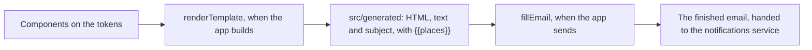

# @zigordev/email

The emails of the platform's apps: messages built with React Email on the design tokens, rendered into finished HTML and plain text when the app builds, and filled in with their values when the app sends them. Every message exists in English and Spanish.

The package is private until the owner publishes it for the first time.

## What it is

Two entries, for two moments:

| Entry                   | When it runs        | What it holds                                                                                                                |
| ----------------------- | ------------------- | ---------------------------------------------------------------------------------------------------------------------------- |
| `@zigordev/email/build` | When the app builds | `EmailLayout`, `EmailHeading`, `EmailText`, `EmailButton` and `EmailFooter` on the tokens, `theme`, and `renderTemplate`     |
| `@zigordev/email`       | When the app sends  | `fillEmail(template, values)`, and the standard messages ready to fill, starting with `verifyEmail({ lang, product, link })` |

A template is a subject, the HTML and the plain text of one message in one language, with places to fill written as `{{name}}`. React Email is a library that writes emails as React components and turns them into the old-fashioned HTML that mail clients read.

## Why we have it

Every product sends email, starting with the message that confirms an address at sign-up. Each message has to look like the brand, read well in every mail client, and exist in both languages. Without the package, each product would write its own HTML for mail clients, and each would get a different part of it wrong.

[Record 0047](../../docs/adr/0047-emails-are-rendered-at-build-and-filled-in-at-send.md) explains the two moments. React Email costs a running service about 46 MB of memory and 176 ms to load, measured on 2026-11-25, and an API container has 256 MB. So React Email runs only when an app builds, and the running service fills in strings.

## How it works here



- **The theme.** The emails wear the light mode of the tokens: the page, the raised card, the text, the lavender button and the 4 px and 6 px corners. Many mail clients read colours only as hexadecimal, so Lightning CSS turns each colour of the tokens into that form, into `src/generated/theme.ts`.
- **The render.** `renderTemplate(element, subject)` gives the HTML and the plain text of a message. Headings keep their case in the plain text, so a place such as `{{name}}` in a heading survives. A message whose plain text would lose a place fails to render.
- **The saved copies.** An app commits its rendered templates in `src/generated/`, and a test renders them again and fails when they differ. The package does the same for its own messages, in both languages.
- **The fill.** `fillEmail` puts each value in its places. In the HTML each value is escaped, so a name cannot add markup. A link must start with `https://` or `http://`. A missing value, or a value with no place, fails the send.

Nothing differs between the laptop and production: the same saved templates are filled in both.

## How to use it

Sending a standard message takes the send entry only:

```ts
import { verifyEmail } from '@zigordev/email';

const email = verifyEmail({ lang: 'es', product: 'Notes', link: confirmationUrl });
await addToOutbox(tx, { topic, event: emailRequested, data: { to, ...email } });
```

A product's own message is a component, rendered at build. Add React Email as a dev dependency:

```bash
pnpm add @zigordev/email
pnpm add --save-dev react-email react react-dom
```

```ts
import { createElement as h } from 'react';
import {
  EmailButton,
  EmailHeading,
  EmailLayout,
  EmailText,
  renderTemplate,
} from '@zigordev/email/build';

export const noteShared = {
  en: await renderTemplate(
    h(
      EmailLayout,
      { lang: 'en', preview: '{{name}} shared a note with you' },
      h(EmailHeading, null, '{{name}} shared a note with you'),
      h(EmailText, null, 'Open it to read it and to add your own lines.'),
      h(EmailButton, { href: '{{link}}' }, 'Open the note')
    ),
    'A note from {{name}}'
  ),
};
```

A script of the app writes such templates into its `src/generated/`, and a test compares them with a fresh render. At send time the app fills them:

```ts
import { fillEmail } from '@zigordev/email';
import { noteShared } from './generated/emails.ts';

const email = fillEmail(noteShared[lang], { name: owner.name, link });
```

## How to check that it works

- `pnpm exec vitest run --project email` in `toolkit` renders the standard messages in English and Spanish and compares them with their saved copies, checks the theme against the tokens, and fills the templates.
- When the saved copies differ after a change of React Email or of the tokens, `pnpm --dir packages/email run generate` renders them again. Read the difference before you commit it.
- When a send fails with `The email needs a value for ...`, the code passes fewer values than the template has places. `placeholdersOf(template)` lists them.
- To see a message, write its `html` to a file and open it in a browser, or send it to Mailpit on the laptop.
