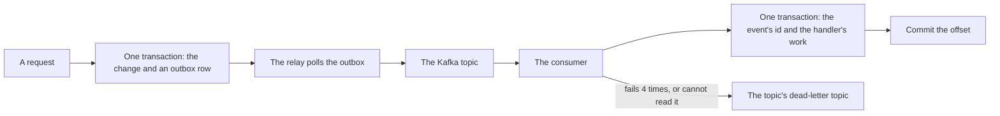

# @zigordev/events

Events between the services of the platform, over Kafka: typed events, a send that is never lost once a change is saved, a consumer that retries and then sets a message aside, duplicates skipped, traces that cross Kafka, and the health and metrics of all of it.

## What it is

An event is a short message that says something happened, such as "a note was created". One service sends it, and any service that cares reads it. Kafka is the broker in between: a server that keeps the messages of each topic in order, so that a reader can take them at its own pace. [Record 0039](../../docs/adr/0039-apache-kafka-is-the-broker-one-node-on-the-host.md) chose Apache Kafka, and [record 0040](../../docs/adr/0040-apps-use-kafka-only-through-zigordev-events.md) says that apps use it only through this package.

| Export                                    | What it is                                                                                                   |
| ----------------------------------------- | ------------------------------------------------------------------------------------------------------------ |
| `defineEvent({ type, version, schema })`  | An event's name, its version and its Zod schema, written once and used by the sender and the reader          |
| `addToOutbox(tx, message)`                | Saves an event in the app's own database, inside the transaction of the change it describes                  |
| `defineConsumer(definition)`              | What a consumer reads, the events it knows, and the function that handles each one                           |
| `startEvents(options)`                    | Starts the relay that sends the outbox to Kafka and every consumer, and gives the health part and a `stop()` |
| `kafkaSettings`                           | The three settings an app reads, as Zod fields for its config schema                                         |
| `eventsOutbox`, `handledEvents`           | The two tables, as Drizzle tables, for the app's schema and migrations                                       |
| `createEnvelope`, `readEnvelope`          | The format of a message on Kafka, for a test or a tool that reads a topic by hand                            |
| `deadLetterTopicOf`, `defaultRetryDelays` | Where a message goes when it cannot be handled, and how long the consumer waits between tries                |

## Why we have it

Sending an event looks easy, and goes wrong in three ways that every app would otherwise meet on its own:

- **A send lost between the database and Kafka.** An app saves a change, then sends the event, and crashes in between. The change exists and the event never leaves. Or Kafka is down for a minute. The outbox closes that gap: the event is saved in the same transaction as the change, so both exist or neither does, and a relay sends it once Kafka answers.
- **A message handled twice.** Kafka promises that a message arrives at least once, not exactly once. A restart in the wrong second delivers it again. The consumer writes the event's id in the same transaction as its work, and skips an id it has already seen.
- **A message that can never be handled.** A bug or bad data makes a handler fail every time. Without a limit it blocks every message behind it. The consumer tries three more times with growing pauses, then moves the message to a dead-letter topic and goes on.

It also keeps the telemetry the same in every app, so one dashboard and one set of alerts cover them all. Without it, every app would pick its own Kafka client, its own names and its own retries, and a later change of client would touch every app. With it, the client, `@platformatic/kafka`, is imported here and nowhere else.

## How it works here



### The broker

Production runs one Kafka node on the host, and the laptop runs the same in `@zigordev/stack`. Both come from `platform`, which also makes every topic and every access rule as code. This package never creates a topic, and the broker refuses to create one on first use.

Each app signs in with its own user and a long random password, with SCRAM-SHA-512, as [record 0041](../../docs/adr/0041-each-app-signs-in-to-kafka-with-its-own-password.md) says. The laptop signs in the same way, with throwaway passwords.

### An event on the wire

Each message is one JSON object, and the message's key decides its partition, so messages with the same key stay in order:

```json
{
  "id": "4c3f2b9e-1a7d-4e6f-9b8a-2d5c7e1f0a3b",
  "type": "note.created",
  "version": 1,
  "occurredAt": "2026-11-25T09:00:00.000Z",
  "data": { "noteId": "0193a1b2-c3d4-7e5f-8a9b-0c1d2e3f4a5b", "title": "Buy milk" }
}
```

A change to what an event holds gets a new version, such as `note.created` version 2, and a consumer lists every version it can read.

### The outbox and the relay

`addToOutbox` writes one row in `events_outbox`: the topic, the key, the event, and the trace of the request that saved it. The relay reads up to 100 rows each second, oldest first, sends them, and deletes them in the same transaction. It locks what it reads with `FOR UPDATE SKIP LOCKED`, so two running copies of the app, as during a deploy, never send the same rows at once. When a send fails, the rows stay, the relay writes `events.relay_failed`, and it tries again after a pause that doubles each time, up to 30 seconds.

### The consumer

A consumer belongs to a group, which is the app's name for one job. Kafka gives each group every message once, and remembers how far the group has read. A new group starts at the oldest message, so nothing sent before its first start is missed.

The consumer handles one message at a time:

1. It reads the message. A message that is not JSON, not an event, an event it does not know, or data that breaks the schema goes to the dead-letter topic at once, because trying again cannot fix it.
2. In one transaction, it writes the group and the event's id into `events_handled`, and calls the handler. When the id is already there, it skips the event. When the handler throws, the transaction rolls back, so nothing of the failed try is kept.
3. A failed try is tried again after 1, 5 and 25 seconds. After the fourth failure, the message goes to the dead-letter topic.
4. It commits the offset, so the group moves on.

The dead-letter topic of `notes.requests` is `notes.requests.dead-letter`. The message keeps its key, its bytes and its headers, and gains six headers that say why: `dead-letter.reason` (`invalid` or `failed`), `dead-letter.detail` (what was wrong, or the error's name), and the topic, partition, offset and group it came from. The detail never holds the error's message, which can hold an address.

A stop waits for the message in hand, or ends a pause between tries without committing, so the message comes back after the restart. A consumer that loses Kafka starts again by itself, after a pause that doubles up to 30 seconds. Rows of `events_handled` older than 30 days are deleted every hour.

### What it reports

Every message leaves a trace that continues the request that saved it, and nothing personal reaches a span, a log line or a metric label: no key, no body, no address.

| Span              | Kind     | When                                                                                                                                                                              |
| ----------------- | -------- | --------------------------------------------------------------------------------------------------------------------------------------------------------------------------------- |
| `send <topic>`    | producer | The relay sends an event that was saved inside a trace. It is a child of that trace, and the trace travels on in the message's headers                                            |
| `process <topic>` | consumer | The consumer handles a message, as a child of the send. The handler's own queries are its children. It carries the topic, the partition, the offset, the group and the event's id |

An empty poll of the outbox starts no trace, as the platform's rule for background work asks.

| Metric                               | Kind      | Labels                     | Counts                                                  |
| ------------------------------------ | --------- | -------------------------- | ------------------------------------------------------- |
| `messaging.client.sent.messages`     | counter   | topic, `error.type`        | Messages the relay sent, and those that failed to send  |
| `messaging.client.consumed.messages` | counter   | topic, group               | Messages a consumer handled, skipped or set aside       |
| `messaging.process.duration`         | histogram | topic, group, `error.type` | How long one message took, with its tries               |
| `zigordev.events.retries`            | counter   | topic, group               | Tries that failed and were tried again                  |
| `zigordev.events.duplicates`         | counter   | topic, group               | Messages skipped because their event was handled before |
| `zigordev.events.dead_letters`       | counter   | topic, group, reason       | Messages moved to a dead-letter topic                   |
| `zigordev.events.outbox.backlog`     | gauge     | none                       | Events in the outbox, waiting to be sent                |
| `zigordev.events.outbox.oldest_age`  | gauge     | none                       | Seconds the oldest of them has waited                   |
| `zigordev.events.consumer.lag`       | gauge     | topic, group               | Messages on a topic that the group has not handled yet  |

The labels are the standard names of OpenTelemetry: `messaging.destination.name` for the topic and `messaging.consumer.group.name` for the group. The app's name comes with every metric, as it does for all telemetry.

| Log event                    | Level | Means                                                             |
| ---------------------------- | ----- | ----------------------------------------------------------------- |
| `events.relay_failed`        | warn  | A send to Kafka failed. The events stay in the outbox             |
| `events.handling_retried`    | warn  | A handler failed, and the consumer will try again                 |
| `events.dead_lettered`       | error | A handler failed for the last time, and the message was set aside |
| `events.message_rejected`    | error | A message could not be read, and was set aside at once            |
| `events.consumer_restarting` | warn  | A consumer lost Kafka, and starts again after a pause             |
| `events.prune_failed`        | warn  | Old rows of `events_handled` could not be deleted this hour       |

The health part is named `kafka`, and is not required: without Kafka the app still saves its changes and its events, so `/health` answers `degraded`, not `error`. It is `up` when Kafka answers and every consumer is reading.

## How to use it

Add the package and the libraries it shares with the app:

```bash
pnpm add @zigordev/events @opentelemetry/api drizzle-orm pg zod
```

Add the three settings to the app's config schema, from [`@zigordev/config`](../config/README.md):

```ts
import { kafkaSettings } from '@zigordev/events';

const schema = z.object({
  ...service,
  ...kafkaSettings,
});
```

| Variable         | Holds                                                                              |
| ---------------- | ---------------------------------------------------------------------------------- |
| `KAFKA_BROKERS`  | The brokers, as `host:port`, separated by commas                                   |
| `KAFKA_USERNAME` | The app's Kafka user, the same as its name                                         |
| `KAFKA_PASSWORD` | The app's password. In production it comes from Parameter Store, like every secret |

Export the two tables from the app's schema file, so that drizzle-kit writes them into the app's migrations, as the [`add-migration` skill](../../.claude/skills/add-migration/SKILL.md) does for any table:

```ts
export { eventsOutbox, handledEvents } from '@zigordev/events';
```

The worked example is a notes API that tells other services when a note is created, and reads that event itself to keep a count:

```ts
import { addHealthComponent } from '@zigordev/api';
import { addToOutbox, defineConsumer, defineEvent, startEvents } from '@zigordev/events';
import { sql } from 'drizzle-orm';
import * as z from 'zod';
import { counts, notes } from './db/schema.ts';

export const noteCreated = defineEvent({
  type: 'note.created',
  version: 1,
  schema: z.object({ noteId: z.uuid(), title: z.string() }),
});

app.post('/api/v1/notes', async (request) => {
  return app.db.transaction(async (tx) => {
    const [note] = await tx.insert(notes).values(request.body).returning();
    await addToOutbox(tx, {
      topic: 'notes.events',
      event: noteCreated,
      data: { noteId: note.id, title: note.title },
      key: note.id,
    });
    return note;
  });
});

const events = startEvents({
  connection: {
    clientId: config.OTEL_SERVICE_NAME,
    brokers: config.KAFKA_BROKERS,
    username: config.KAFKA_USERNAME,
    password: config.KAFKA_PASSWORD,
  },
  db: app.db,
  logger,
  consumers: [
    defineConsumer({
      group: 'notes-api.counts',
      topics: ['notes.events'],
      events: [noteCreated],
      handle: async (event, { tx }) => {
        await tx.update(counts).set({ notes: sql`${counts.notes} + 1` });
      },
    }),
  ],
});
addHealthComponent(app, events.health);
app.addHook('onClose', () => events.stop());
```

- The handler's type knows every event the consumer lists, so `event.data.noteId` is typed.
- The handler does its work through `tx`, so its work and the mark that the event was handled commit together.
- `relay: false` leaves the relay out, for an app that only reads. `relay: { interval, batchSize }` changes how often it polls and how much it takes.
- `retryDelays` changes the pauses between tries, and `deadLetterTopicOf` names the dead-letter topic.

In tests, [`@zigordev/test/kafka`](../test/README.md) starts a real Kafka 4.4.0 with a signed-in user, the same way `@zigordev/test/postgres` starts PostgreSQL.

## How to check that it works

`pnpm exec vitest run --project events --project events:db` in `toolkit` runs this package's tests. The second project needs Docker, and runs every path above against a real Kafka and a real PostgreSQL: the send, the rollback, a duplicate, a retry, the dead-letter topic for a failure and for a message it cannot read, a stop during a pause, the trace across Kafka, the metrics and the health part.

| What you see                                                            | What it means, and what to do                                                                                                                                                          |
| ----------------------------------------------------------------------- | -------------------------------------------------------------------------------------------------------------------------------------------------------------------------------------- |
| `zigordev.events.outbox.oldest_age` keeps growing                       | The relay cannot send. Read `events.relay_failed`: a refused sign-in names the password, a missing topic names the topic, which `platform` has to make                                 |
| `zigordev.events.consumer.lag` keeps growing                            | A consumer is not reading, or reads slower than messages arrive. Look for `events.consumer_restarting`, and at `messaging.process.duration`                                            |
| `zigordev.events.dead_letters` goes up                                  | A message was set aside. `events.dead_lettered` or `events.message_rejected` names the topic, the event and why. Fix the cause, then send the message again from its dead-letter topic |
| `/health` answers `degraded` with `kafka` down                          | The app cannot reach Kafka, or a consumer is starting again. Changes and events are still saved, and go out when Kafka answers                                                         |
| A new consumer group reads nothing                                      | Check its topics and its access rules in `platform`. A group that may not read a topic is refused by the broker                                                                        |
| A test fails with `Could not find a working container runtime strategy` | Docker is not running. Start it, and run the test again                                                                                                                                |
