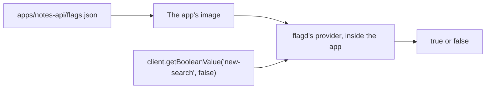

# @zigordev/flags

Feature flags for the apps of the platform. A flag lets unfinished work ship switched off, and lets it be switched on later by a one-line change. Code asks for a flag through OpenFeature, and the answer comes from the app's own `flags.json`.

The package is private until the owner publishes it for the first time.

## What it is

| Export                      | What it is                                                                                                       |
| --------------------------- | ---------------------------------------------------------------------------------------------------------------- |
| `startFlags({ app, file })` | Reads the app's flags file, and gives an OpenFeature client to ask with, the health part `flags`, and a `stop()` |
| `flagsSettings`             | The one setting an app reads, `FLAGS_FILE`, as a Zod field for its config schema                                 |

OpenFeature is the open standard for asking whether a feature is on: code asks a client, and a provider behind it finds the answer. flagd is OpenFeature's own flag format and rules. Here its provider reads the file inside the app, so no flag server runs.

## Why we have it

Every change merges and deploys by itself once `check` is green, so a feature that is not finished has to ship switched off. The core rules say so: unfinished work ships behind a flag that carries a removal date.

[Record 0046](../../docs/adr/0046-each-app-reads-its-own-flags-in-the-app.md) holds how: each app reads its own `flags.json`, because the host reads only a product's compose files and its list of secrets. [Record 0030](../../docs/adr/0030-no-console-for-feature-flags-for-now.md) keeps a flag change a pull request, which takes effect with the deploy.

Without flags, a half-built feature would wait on a branch for days, against the rule that a branch lives for hours. Without removal dates, flags would pile up, and nobody would know which ones still matter.

## How it works here



- **The file.** Each app has a `flags.json` beside its `package.json`, listed in its `files`, so its image carries it. The file follows flagd's format: each flag has a state, its variants, the default variant and, here, a removal date.
- **The answer.** The provider evaluates each flag in the app, with no network call. A flag can answer differently for different callers through flagd's targeting rules, from the context the code passes.
- **The default.** Code always passes a default. A flag that is switched off, missing or broken answers that default, and the details say why.
- **The start.** `startFlags` refuses a file it cannot read or parse, so the app stops as it starts, and the deploy's health gate keeps the old version.
- **The removal date.** The `flags` rule of `zigordev check` reads every `flags.json` of the repo, in `pnpm check` and in the pipeline. It fails on a flag without `metadata.removeBy` and on a flag whose date has passed, and names the file and the line.
- **The health answer.** The part `flags` is up once the file is read. It is not required, because every flag has a default.

Nothing differs between the laptop and production: the same file is read in both.

## How to use it

Add the package and the libraries it shares with the app:

```bash
pnpm add @zigordev/flags @openfeature/server-sdk @grpc/grpc-js zod
```

Write the app's `flags.json`. A new flag starts switched off:

```json
{
  "$schema": "https://flagd.dev/schema/v0/flags.json",
  "flags": {
    "new-search": {
      "state": "ENABLED",
      "variants": { "on": true, "off": false },
      "defaultVariant": "off",
      "metadata": { "removeBy": "2027-03-31" }
    }
  }
}
```

Read the file's path in the config, with the app's own file as the default, and start the flags with the app:

```ts
import { fileURLToPath } from 'node:url';
import { addHealthComponent } from '@zigordev/api';
import { flagsSettings, startFlags } from '@zigordev/flags';

const schema = z.object({
  ...service,
  FLAGS_FILE: flagsSettings.FLAGS_FILE.default(
    fileURLToPath(new URL('../flags.json', import.meta.url))
  ),
});

const flags = await startFlags({ app: config.OTEL_SERVICE_NAME, file: config.FLAGS_FILE });
addHealthComponent(app, flags.health);
app.addHook('onClose', () => flags.stop());

const results = (await flags.client.getBooleanValue('new-search', false))
  ? await searchEverywhere(query)
  : await searchTitles(query);
```

To switch the feature on, a pull request sets `"defaultVariant": "on"`. To finish, a pull request removes the flag and the code that asks for it, before its date. A test sets a flag by pointing `FLAGS_FILE` at a file of its own.

## How to check that it works

- `pnpm exec vitest run --project flags` runs the package's tests on real files: a flag on, a flag switched off, a missing flag, targeting, the health part and a broken file.
- `pnpm exec zigordev check flags` lists every flag without a removal date or past it.
- When a flag always answers its default, the details from `getBooleanDetails` say why: `FLAG_NOT_FOUND` for a name that is not in the file, or the flag is `DISABLED`.
- When the app does not start and says `The flags file ... cannot be read`, its image lacks the file: the app's `package.json` must list `flags.json` in `files`, and its Dockerfile copies it.
