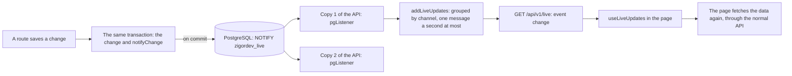

# @zigordev/live

Live updates for the apps of the platform. When something changes, every page that shows it hears about it at once and fetches it again. The API tells its pages what changed over Server-Sent Events, and every running copy of the API hears every change through PostgreSQL.

## What it is

| Export                                   | Entry                   | What it is                                                                                                                        |
| ---------------------------------------- | ----------------------- | --------------------------------------------------------------------------------------------------------------------------------- |
| `addLiveUpdates(app, options)`           | `@zigordev/live/server` | Adds the route `GET /api/v1/live` to an API built on `@zigordev/api`, with its health part `live`, its metrics and its clean stop |
| `pgListener({ url, logger })`            | `@zigordev/live/server` | The one PostgreSQL connection of each running copy of the API that listens for changes                                            |
| `notifyChange(tx, notice)`               | `@zigordev/live/server` | Sends a notice inside the transaction that saves the change                                                                       |
| `useLiveUpdates({ onChange, onResync })` | `@zigordev/live/react`  | The React hook that keeps a page's stream open, connects again after a break, and hands each change to the page                   |
| `liveNotice`, `changeMessage`            | `@zigordev/live`        | The Zod schemas of a notice and of a message, written once for the API and the page                                               |
| `livePath`, `changeEvent`, `resyncEvent` | `@zigordev/live`        | The route, `/api/v1/live`, and the names of its two events, `change` and `resync`                                                 |

Server-Sent Events are a response that stays open and carries one event after another, from the server to the page. The browser reads them with `EventSource`, and the stream runs over plain HTTP, so the ingress and Cloudflare carry it like any other request. PostgreSQL's `LISTEN` and `NOTIFY` are messages between database connections: a connection that listens on a channel hears every notice sent there, once the transaction that sent it commits.

## Why we have it

A page that shows a person's notes is stale as soon as the notes change elsewhere: in another tab, on another device, or through the API. Without live updates the person sees old data until they reload, and two tabs disagree.

[Record 0044](../../docs/adr/0044-live-updates-reach-pages-as-server-sent-events.md) holds the design: Server-Sent Events under `/api/v1`, behind sign-in, a notice in the same transaction as the change, a message that names what changed and never the data, at most one message per channel each second, and a heartbeat. [Record 0057](../../docs/adr/0057-live-updates-ship-as-their-own-package.md) holds why it is a package of its own.

No new library was needed. Fastify writes the stream, and `pg`, the driver every API already has, listens.

## How it works here



- **The notice.** A notice names a channel, a type of change and, when there is one, an id, such as `{ channel: 'notes:<owner>', type: 'note.updated', id }`. It never carries the data, so a page reads the data through the API, where the normal checks decide what the person may see. A type is lower case, `<thing>.<what happened>`. The schema keeps a notice far below the 8,000 bytes that PostgreSQL allows.
- **The same transaction.** `notifyChange` runs `pg_notify` on the transaction it is given. PostgreSQL delivers the notice only when that transaction commits, so a change that rolls back sends nothing, and no page hears of a change before it can read it.
- **The channels.** `channelsOf(principal, request)` returns the channels the person who opens the stream may hear. A notice reaches only the streams on its channel. The template gives each person `notes:<their id>`, so each person hears only about their own notes.
- **The stream.** `GET /api/v1/live` needs sign-in, as every route does, and stays out of the OpenAPI pages. It answers `text/event-stream` with `cache-control: no-cache, no-transform` and `x-accel-buffering: no`, so nothing between the API and the page holds the events back, and starts with the line `: ready`. A heartbeat line follows every 30 seconds, so neither the ingress nor Cloudflare closes a quiet stream.
- **One message a second.** The first notice on a channel goes out at once. The notices of the next second wait, and go out together in one message, without repeats. A channel with more than 50 different changes in one second gets `resync` instead of a list.
- **Resync.** The event `resync` asks the page to fetch again everything it shows. The API sends it to every stream when its listener connects to PostgreSQL again, because notices sent while it was away are lost. The hook also calls `onResync` each time its stream opens again after a break.
- **The limits.** A person may keep 10 streams open on one copy of the API. The 11th answers 429 with the code `live.too_many_streams`. A page that reads so slowly that 64 KiB wait unsent loses its stream, and catches up when it connects again.
- **The listener.** Each copy of the API keeps one connection, named `zigordev-live`, that listens on the channel `zigordev_live`. When it breaks, it tries again after 1 second, then 2, 4 and so on up to 30. The health part `live` is up while it listens. It is not required, so the API answers `degraded`, not `error`, while live updates are down.
- **The clean stop.** The stop ends every stream before the server closes, so a deploy never waits for open pages. Each page connects again, reaches the new copy and catches up.
- **The hook.** `useLiveUpdates` opens the stream once the page has rendered in the browser, and returns `connecting`, `open` or `closed`. After a break it waits between half and all of 1 second, then of 2, 4 and so on up to 30. The pause keeps growing while each stream breaks as soon as it opens, and starts over after a stream that stayed open for 10 seconds. The browser entry switches Zod to `jitless`, because Zod otherwise tests whether it may run generated code, and the content security policy of every page reports that test.
- **No trace for a stream.** A stream lasts as long as its page, so a span or a request duration would measure the visit, not the work, and would make the API look slow. `@zigordev/otel` leaves `/api/v1/live` without either. The package counts streams and messages instead:

| Metric                   | Kind                | What it counts                                                                  |
| ------------------------ | ------------------- | ------------------------------------------------------------------------------- |
| `zigordev.live.streams`  | Up-and-down counter | The streams open now on this copy of the API                                    |
| `zigordev.live.messages` | Counter             | The messages written to streams, by `zigordev.live.event`: `change` or `resync` |

| Log event             | Level  | When                                                                 |
| --------------------- | ------ | -------------------------------------------------------------------- |
| `live.listening`      | `info` | The listener listens, at the start and after each break              |
| `live.listen_failed`  | `warn` | The listener lost PostgreSQL or could not reach it, with `retryInMs` |
| `live.notice_invalid` | `warn` | A notice on the channel did not match the schema, and was skipped    |

Nothing differs between the laptop and production. In containers the ingress sends `/api` to the API. The web app's dev server and its page check have no ingress, so they reach the stream through the web app's proxy, which stops its call to the API when the page goes away.

## How to use it

Add the package. An API also needs `pg`, `drizzle-orm`, `fastify`, `@zigordev/api` and `@zigordev/otel`, which it has already, and a web app needs `react`:

```bash
pnpm add @zigordev/live
```

In the API, add the route once, and send a notice in each transaction that changes something a page shows. This is the template's code:

```ts
import { forbidden } from '@zigordev/api';
import { addLiveUpdates, notifyChange, pgListener } from '@zigordev/live/server';

addLiveUpdates(app, {
  listener: pgListener({ url: config.DATABASE_URL, logger }),
  channelsOf: (_principal, request) => {
    if (!request.user) {
      throw forbidden('Live updates are for a person who is signed in.');
    }
    return [`notes:${request.user.id}`];
  },
});

await db.transaction(async (tx) => {
  const [row] = await tx.update(notes).set(change).where(eq(notes.id, id)).returning();
  if (row?.ownerId) {
    await notifyChange(tx, { channel: `notes:${row.ownerId}`, type: 'note.updated', id: row.id });
  }
});
```

In the web app, a small client component asks the server for the page again on each change:

```tsx
'use client';

import { useLiveUpdates } from '@zigordev/live/react';
import { useRouter } from 'next/navigation';

export function LiveNotes() {
  const router = useRouter();
  useLiveUpdates({ onChange: () => router.refresh(), onResync: () => router.refresh() });
  return null;
}
```

The page's content security policy needs nothing more than `connect-src 'self'`, because the stream is on the page's own address.

## How to check that it works

- `pnpm exec vitest run --project live` runs the route with a stand-in listener: sign-in, the headers, the channels, the grouping, `resync`, the heartbeat, the limit, the clean stop, the health part and the metrics.
- `pnpm exec vitest run --project live:db` runs the listener on a real PostgreSQL: a commit, a rollback, a broken notice, a cut connection and an unreachable database. Docker has to run.
- `pnpm --dir packages/live run test:browser` runs the hook in Chromium, with coverage.
- In the browser's developer tools, the network panel shows the request to `/api/v1/live` with the type `eventsource`, and lists each message as it comes.
- When pages stop hearing changes, read the health answer. The part `live` is down while the listener has lost PostgreSQL, and the log line `live.listen_failed` says why and when it tries again.
- When a page gets 429, the person has more than 10 tabs open on one copy of the API.
- When the messages come all at once, late, something between the API and the page holds the stream back. Check that the answer reaches the browser with `cache-control: no-cache, no-transform`.
