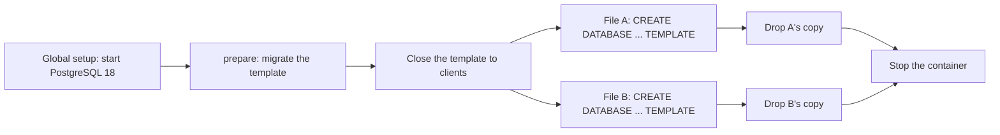

# @zigordev/test

Test helpers for the services of the platform. It starts a real PostgreSQL for a test run, gives every test file its own migrated copy of the database, and builds an app for the API tests.

## What it is

Two entry points. `@zigordev/test/postgres` gives a real database:

| Export                             | What it is                                                                                              |
| ---------------------------------- | ------------------------------------------------------------------------------------------------------- |
| `postgresGlobalSetup(options?)`    | The global setup of a Vitest project: one PostgreSQL container for the whole run, with a template ready |
| `useTestDatabase()`                | In a test file: a copy of the template for this file, made before its tests and dropped after them      |
| `startPostgres(options?)`          | The same start without Vitest: a container, a prepared template and a `stop()`                          |
| `createTestDatabase(templateUrl)`  | The same copy without Vitest: a `url` and a `drop()`                                                    |
| `databaseUrl(serverUrl, database)` | The address of another database on the same server, with the same sign-in                               |
| `postgresImage`                    | `postgres:18-alpine`, the image used when none is given                                                 |

`@zigordev/test/app` gives the harness for API tests:

| Export                              | What it is                                                                                        |
| ----------------------------------- | ------------------------------------------------------------------------------------------------- |
| `useApp(build)`                     | In a test file: the app, built once before its tests and closed after them                        |
| `captureLogs()`                     | A place for the logger to write to, which keeps every line and finds the events in it             |
| `expectProblem(response, expected)` | Checks that an answer is an error in the platform's format, with the status and the code expected |

A template database is a database that PostgreSQL copies to make a new one. Copying a migrated template takes milliseconds. Running the migrations again for every test file would take seconds.

## Why we have it

The platform's test rules ask for two things that are slow or hard to get right alone:

- **A real database.** A test runs against PostgreSQL 18, the version production runs, never against a stand-in. A stand-in hides the bugs that matter: a constraint, a lock, a query that sorts differently.
- **Tests that never see each other's data.** Every test file gets its own copy of the migrated database. Test files run at the same time, and none of them can break another.

Without this package, every service would write its own container start, its own copies and its own clean-up, and each one would differ a little.

## How it works here

Testcontainers starts the container. It is a library that runs throwaway containers for tests through Docker, and removes them when the run ends, even after a crash.



- One container serves the whole run of a Vitest project. Its server runs with `fsync` off, because nothing in a test database has to survive a crash.
- `prepare` receives the template's address, usually to run the migrations. After it, the template refuses new clients, and any client that `prepare` left open is closed, so a copy never waits.
- `useTestDatabase` makes the copy in a `beforeAll` and drops it in an `afterAll`. The tests of one file share it, in order.
- Tests that need a container sit in files named `*.db.test.ts`, in a Vitest project of their own, named `<name>:db`. `pnpm check` runs them. `pnpm check:quick`, which the push hook runs, leaves them out, so a push never waits for Docker.

## How to use it

Install it beside Vitest:

```bash
pnpm add --save-dev @zigordev/test
```

A repo that installs it also needs these three lines under `allowBuilds` in its `pnpm-workspace.yaml`. Testcontainers brings three packages with install scripts that it does not need, and pnpm stops the install with `ERR_PNPM_IGNORED_BUILDS` until each one is named:

```yaml
allowBuilds:
  cpu-features: false
  protobufjs: false
  ssh2: false
```

Until Testcontainers stops bringing `archiver`, a repo also needs this line under `overrides`. Testcontainers 12.2.2 brings `glob` 10.5.0 through `archiver-utils`, with a known flaw, [GHSA-3g3m-2fjr-6pw4](https://github.com/advisories/GHSA-3g3m-2fjr-6pw4), and the Dependencies job fails on it. [Record 0033](../../docs/adr/0033-a-flawed-dependency-of-a-dependency-is-replaced-by-an-override.md) says how such a flaw is handled:

```yaml
overrides:
  archiver-utils>glob: 14.0.6
```

An app keeps its database tests in a second Vitest project, `vitest.db.config.ts` beside its `vitest.config.ts`:

```ts
import { defineProject } from 'vitest/config';

export default defineProject({
  test: {
    name: 'notes-api:db',
    include: ['src/**/*.db.test.ts'],
    globalSetup: ['global-setup.ts'],
    hookTimeout: 60_000,
    testTimeout: 60_000,
  },
});
```

`global-setup.ts` starts PostgreSQL and migrates the template:

```ts
import { postgresGlobalSetup } from '@zigordev/test/postgres';
import { migrate } from './src/db/migrate.ts';

export const setup = postgresGlobalSetup({ prepare: migrate });
```

A test file takes its own database and builds the app on it:

```ts
import { createLogger } from '@zigordev/otel';
import { captureLogs, expectProblem, useApp } from '@zigordev/test/app';
import { useTestDatabase } from '@zigordev/test/postgres';
import { expect, it } from 'vitest';
import { buildApp } from './app.ts';
import { readConfig } from './config.ts';

const database = useTestDatabase();
const logs = captureLogs();
const server = useApp(() =>
  buildApp({
    config: readConfig({ OTEL_SERVICE_NAME: 'notes-api', DATABASE_URL: database.url }),
    logger: createLogger({ service: 'notes-api', destination: logs }),
  })
);

it('answers 404 for a note that does not exist', async () => {
  const url = '/api/v1/notes/0190d4c2-0000-7000-8000-000000000000';
  const response = await server.app.inject({ method: 'GET', url });

  expectProblem(response, { status: 404, code: 'not_found' });
  expect(logs.events()).toEqual([]);
});
```

- Call `useTestDatabase()` before `useApp()`. Hooks run in the order they are written, so the database exists when the app is built, and the app closes before the database is dropped.
- `expectProblem` checks the status, the media type `application/problem+json`, the code, and that the body holds exactly the fields of the platform's error format: `type`, `title`, `status`, `detail`, `instance`, `code` and `params`. It returns the body, for checks on `params`.
- `startPostgres({ image })` takes another image. A product passes the one its `compose.yaml` runs.

## How to check that it works

- `pnpm exec vitest run --project test --project test:db` in `toolkit` runs this package's own tests. The database tests ask the server for its version, and fail on anything but PostgreSQL 18.
- A database test that fails with `Could not find a working container runtime strategy` means Docker is not running. Start Docker Desktop and run it again.
- A test that hangs in its `beforeAll` while it makes the copy usually holds a client open on the template. `prepare` has to close what it opens. The package closes what is left, but only once, right after `prepare`.
- Containers that a crashed run left behind are removed by Testcontainers' own clean-up container, `testcontainers/ryuk`, within seconds.
